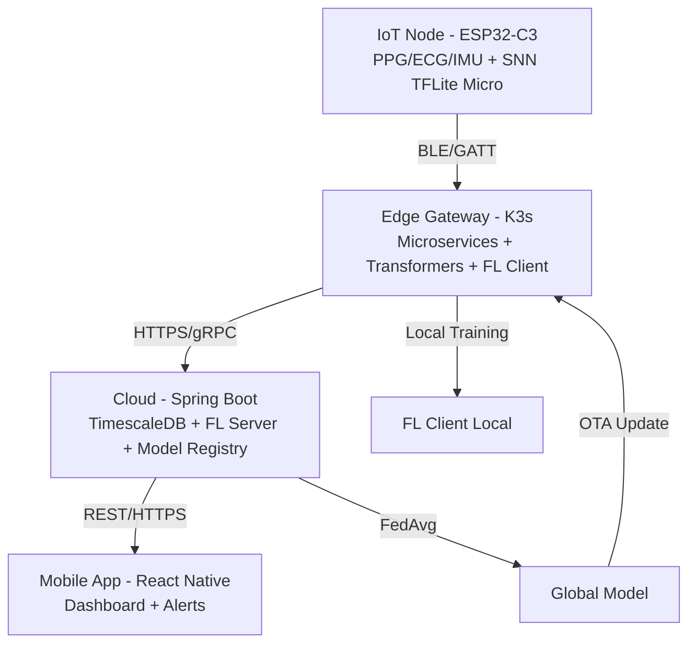

# Overall System Architecture

## 1. Overview

The 3-tier IoMT system integrates Edge AI + Federated Learning: **IoT Node → Edge Gateway → Cloud**. Objectives: reduce latency, reduce communication cost, protect the privacy of medical data.

## 2. 3-Tier Architecture

## 3. Components by Tier

### IoT Tier
- **Hardware:** ESP32-C3, MAX30102, MPU6050, AD8232 (optional)
- **Firmware:** ESP-IDF + FreeRTOS, Sensor Drivers, Signal Processing, TFLite Micro
- **AI:** SNN (LIF/RSNN) – lightweight, < 5ms inference
- **Comm:** BLE 5.0 (GATT) – bandwidth-optimized

### Edge Tier
- **Platform:** K3s/Docker/containerd on Raspberry Pi/Jetson Nano
- **Services:** ble-ingest, signal-processor, buffer-store, local-trainer, model-agent, gateway-api
- **AI:** Time-Series Transformers (Informer/PatchTST), SSL (Contrastive), ONNX/TensorRT
- **FL Client:** Flower client, local epochs, secure weights exchange
- **Storage:** Local buffer (SQLite/filesystem)

### Cloud Tier
- **Backend:** Spring Boot 3.x + REST API + Spring Security + JWT + RBAC
- **DB:** PostgreSQL 14+ + TimescaleDB (time-series hypertables)
- **FL Server:** Flower server with FedAvg/FedProx strategy
- **Model Registry:** Versioned global models, metadata, SHA256
- **CI/CD:** GitHub Actions/GitLab CI + OTA pipeline
- **Auth:** JWT access/refresh

### Mobile Tier
- **Framework:** React Native (TypeScript)
- **Features:** Realtime charts, device list, alerts, history, connection status
- **Notifications:** FCM/OneSignal
- **API:** REST to Cloud, optional direct to Gateway (offline scenarios)

## 4. Data Flow

1. **Acquisition:** Sensors → ADC → Firmware preprocessing
2. **Edge Inference:** SNN local classify (optional) + feature extraction
3. **Streaming:** IoT → Edge via BLE, queued by MQTT/Redis
4. **Processing:** Edge normalizes, windows (30–120s), prepares for Transformer
5. **Local Training (FL):** Periodic on local data (privacy-preserving)
6. **Aggregation:** Edge uploads model weights → Cloud FedAvg → Global model
7. **OTA:** Cloud pushes new global model → Edge model-agent verifies & applies
8. **Visualization:** Cloud stores to TimescaleDB → Mobile app fetches/display + alerts

## 5. Security & Privacy

- **Privacy-by-Design:** Only model weights shared; raw signals stay local
- **Transport:** TLS/HTTPS, mTLS between Edge services (recommended)
- **AuthN/Z:** JWT + RBAC
- **Data:** Hashed device IDs, no PII in measurements
- **Model Integrity:** SHA256 checksum + versioning on OTA
- **Ethics:** IRB approval, Informed Consent for clinical trial

## 6. Non-Functional Requirements

| Aspect | Target | Notes |
|---|---|---|
| Latency (E2E) | < 150–300ms | From acquisition to alert/display |
| IoT Inference | < 5ms | SNN on ESP32-C3 |
| API p95 | < 200ms | Cloud REST |
| Availability (Edge) | ≥ 99% lab/demo | Target for prototype |
| Scalability | 5–30 nodes tested | Expandable design |
| Energy (IoT) | Minimize EDP | Measure via INA219 |
| Comm Cost | Min vs raw upload | FL benefit |

## 7. Deployment View

| Env | Target | Purpose |
|---|---|---|
| Dev | Local (Docker Compose) | Rapid iteration |
| Edge Dev | Pi/Jetson + K3s | Integration test |
| Cloud Dev | VM/Host + Docker | Backend + FL Server |
| Clinical | Controlled env | 10–30 users trial (with ethics) |

## 8. Tech Mapping

| Layer | Primary Tech | Alternatives |
|---|---|---|
| IoT FW | ESP-IDF | Arduino Core |
| TinyML | TFLite Micro | MicroTVM (eval later) |
| SNN Training | snnTorch/Norse | SpikingJelly |
| Edge Orchestration | K3s | k3d (dev), MicroK8s |
| Streaming | MQTT + Redis Streams | NATS JetStream |
| Edge ML | PyTorch + ONNX + TensorRT | OpenVINO (Intel) |
| FL | Flower | FedML, PySyft (less fit) |
| Cloud API | Spring Boot | FastAPI (Python alt) |
| TimeSeries DB | TimescaleDB (Postgres) | InfluxDB |
| Mobile | React Native | Flutter |
