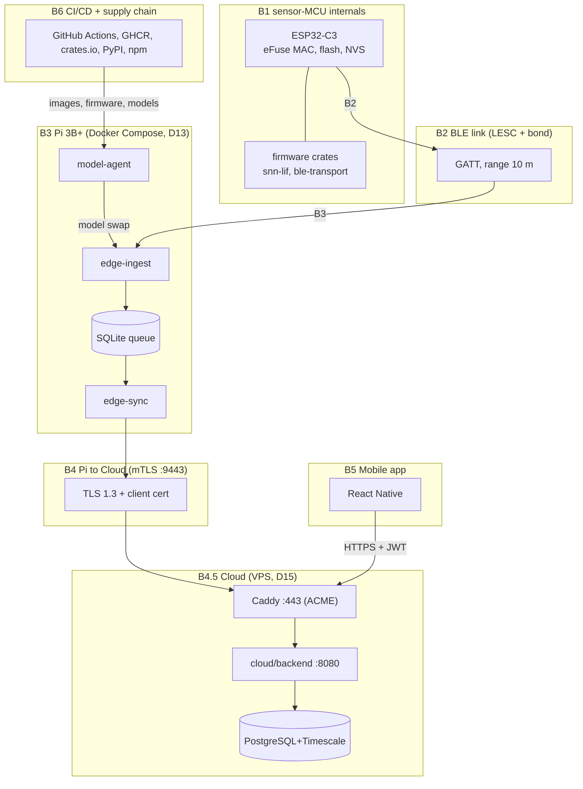
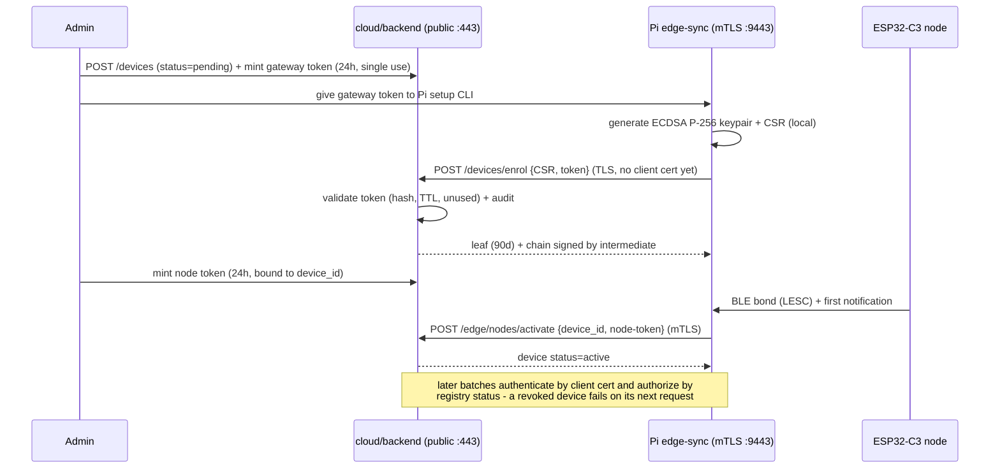
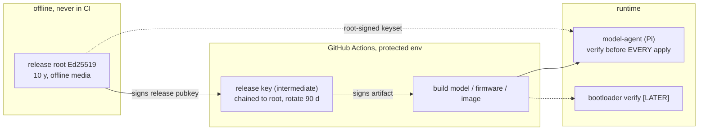

# 07 — Security, Identity & Privacy (medical-grade IoT, student team)

**Role:** Principal Architect. **Scope:** design only — no code (D10); config/schema snippets are documentation.
**Language:** English (D11). **Writes:** this file only.
**Binding inputs:** `DECISIONS.md` (D1–D20), `01` §0/§2.1/§2.2 + `deploy/` tree, `03` §7 (MET table format), `05` §8 (verification adjustments).
**ID ranges:** metrics `MET-30..MET-39`; ADRs `ADR-0014..ADR-0016`.

Assumptions used throughout (every number has one):
- **A1** ≤ 30 sensor nodes, ≤ 30 users, 1 Pi gateway, 1 cloud VPS (2 vCPU / 4 GB / 40 GB SSD — same class as `05 §1.5`).
- **A2** Upload = ~1 Hz vitals + 1 feature row per window (D18); edge batches every 60 s ⇒ 30 nodes × 60 rows × ~200 B ≈ **360 KB/batch**.
- **A3** 1 developer (learner); the security MVP gate (§3.12) is **4–6 person-weeks**, split into milestones G0-a/G0-b/G0-c.
- **A4** Pi 3B+ has **no battery-backed RTC** ⇒ boot clock is 1970 until NTP syncs.
- **A5** Nothing here is legal advice; Vietnam notes (§3.8) require confirmation by qualified counsel.

---

## 1. Goals and non-goals

### 1.1 Goals
1. **G1** No plaintext protected health information (PHI) on any hop: BLE → Pi → cloud → mobile.
2. **G2** Every actor (node, gateway, user, CI job) has a **unique, revocable identity**; no shared or default credentials after provisioning.
3. **G3** Every read of patient data is **attributable and tamper-evident** (hash-chained audit).
4. **G4** Privacy by design — minimisation, hashed device IDs, consent records, export/deletion path — in place **before any real person wears a device**.
5. **G5** Integrity of what the Pi runs and applies: signed models (already MVP per `04` RW-06), signed firmware, pinned supply chain.
6. **G6** Boring and student-operable: no KMS/HSM, no external IdP, **no new daemon on the 1 GB Pi** (D13/D14 budget), no Redis (ADR-0008, `05 §8`).

### 1.2 Non-goals
1. **NG1** Formal certification (ISO 27001, IEC 62443) and third-party penetration tests — Phase 2+.
2. **NG2** Perfect anti-tamper on the wearable: ESP32-C3 flash encryption / secure boot v2 are `[LATER]` (§6); residual risk is documented for the lab MVP.
3. **NG3** Encryption against a malicious cloud operator — the self-managed VPS is trusted (D15).
4. **NG4** FL cryptographic guarantees (secure aggregation, differential privacy) = `[LATER]` (§3.8); FL itself is `[LATER]`.
5. **NG5** HSM-grade key custody; 1 Pi and 1 VPS do not justify it.

---

## 2. Requirements (numbered, testable)

Format per `03 §2` (atomic, RFC 2119, ≥1 test each). `REQ-SEC-*` is this document's namespace; §10 maps them into the WP specs.

| ID | Requirement | Verify (test) |
|---|---|---|
| REQ-SEC-001 | Every sensor node MUST be identified as `device_id = HMAC-SHA256(DEVICE_ID_SALT, ble_mac)` truncated to 128 bit (32 hex); the raw BLE MAC MUST NOT appear in any cloud payload, log, or metric. | T-REQ-SEC-001-01: scan captured uplink + backend logs for MAC patterns = 0 hits |
| REQ-SEC-002 | The edge→cloud uplink MUST use mTLS (ECDSA P-256 leaf signed by the project CA); a handshake without a client certificate MUST be rejected before any HTTP byte. | T-REQ-SEC-002-01: request without cert → TLS alert, empty response body |
| REQ-SEC-003 | Gateway enrolment MUST use a single-use token (≥ 256 bit random, stored hashed, TTL ≤ 24 h); replay of a consumed token MUST fail with 410. | T-REQ-SEC-003-01: enrol twice with the same token → second returns 410 |
| REQ-SEC-004 | Node activation MUST require a single-use node token bound to `device_id`, presented by an already-enrolled gateway; an untokened node MUST be rejected and audited. | T-REQ-SEC-004-01: rogue node → 403 + audit row `node.activate deny` |
| REQ-SEC-005 | Leaf certificate lifetime MUST be ≤ 90 days; automatic renewal MUST run at ≤ 60 days (2/3 of lifetime) with no uplink downtime. | T-REQ-SEC-005-01: clock-forward test renews; old serial rejected after expiry |
| REQ-SEC-006 | Revoking a device or gateway MUST take effect on the next request (≤ 60 s) for both REST and the mTLS uplink. | T-REQ-SEC-006-01: revoke → next uplink batch = 401 within 60 s |
| REQ-SEC-007 | Sensor↔Pi bonding MUST use BLE LE Secure Connections only; legacy pairing MUST be disabled in BlueZ and in firmware. | T-REQ-SEC-007-01: BlueZ config + firmware test assert SC-only |
| REQ-SEC-008 | Key material MUST be generated where it is used (node, Pi, VPS); private keys MUST NOT be transmitted, logged, or committed. | T-REQ-SEC-008-01: `gitleaks` clean + CSR-only enrolment trace |
| REQ-SEC-009 | Passwords MUST be hashed with argon2id (m ≥ 19456 KiB, t ≥ 2, p ≥ 1, ≥ 16 B random salt, ≥ 32 B tag); plaintext MUST NOT be stored or logged. | T-REQ-SEC-009-01: DB dump has no plaintext; parameters asserted in config test |
| REQ-SEC-010 | Access JWT MUST expire ≤ 15 min; refresh tokens MUST rotate on every use, stored hashed; reuse of a rotated refresh token MUST revoke the whole session family. | T-REQ-SEC-010-01: replay old refresh → 401 + family revoked |
| REQ-SEC-011 | Every protected endpoint MUST enforce role AND ownership; another subject's object MUST return 404 (no existence leak). | T-REQ-SEC-011-01: patient A reads B's measurement → 404 |
| REQ-SEC-012 | The permission matrix of §3.5 MUST be the single authorization source, mirrored in `cloud-api.openapi.yaml` security schemes and in one middleware. | T-REQ-SEC-012-01: table-driven test over 3 MVP roles × 5 resources (caregiver/researcher `[LATER]`) |
| REQ-SEC-013 | Every tenant-scoped query MUST include `tenant_id = $jwt.tenant_id`; cross-tenant identifiers MUST return 404. | T-REQ-SEC-013-01: second-tenant fixture id → 404 on every route |
| REQ-SEC-014 | The login rate limit MUST be checked BEFORE argon2 verification; > 5 failures / 5 min / IP → 429. | T-REQ-SEC-014-01: burst of 100 logins → ≤ 5 hash computations |
| REQ-SEC-015 | Public traffic MUST use TLS ≥ 1.2 (TLS 1.3 preferred; HSTS in prod); the internal mTLS listener MUST offer TLS 1.3 only. | T-REQ-SEC-015-01: `testssl.sh` finds no TLS 1.0/1.1 and no weak cipher |
| REQ-SEC-016 | Request size limits MUST be enforced: 64 KiB user JSON, 512 KiB edge batch, 8 KiB headers, 2 KiB URL; oversize → 413. | T-REQ-SEC-016-01: 1 MiB body → 413, process not OOM-killed |
| REQ-SEC-017 | CORS MUST be deny-by-default: no `*`, only configured origins; the React Native client MUST NOT depend on CORS. | T-REQ-SEC-017-01: unknown Origin → no ACAO header |
| REQ-SEC-018 | Every response MUST carry `X-Content-Type-Options: nosniff`, `Referrer-Policy: no-referrer`, `X-Frame-Options: DENY`; PHI routes MUST carry `Cache-Control: no-store`. | T-REQ-SEC-018-01: header assertions over the route table |
| REQ-SEC-019 | Write endpoints MUST reject unknown JSON fields and validate against the contract; malformed input MUST NOT reach the DB. | T-REQ-SEC-019-01: 1 000 fuzzed bodies → 0 panics, 0 partial writes |
| REQ-SEC-020 | Every read of patient-scoped data (measurements, alerts, device assignment) MUST append an audit row, including denials. | T-REQ-SEC-020-01: 200 mixed requests → audit count matches exactly |
| REQ-SEC-021 | The audit table MUST be append-only for the app role (`GRANT SELECT, INSERT` only); each row MUST chain `row_hash = SHA256(prev_hash ‖ canonical(row))`. | T-REQ-SEC-021-01: UPDATE/DELETE as app role denied; chain verifier passes |
| REQ-SEC-022 | The current chain head hash MUST be emitted daily to the log stream as an external anchor. | T-REQ-SEC-022-01: one anchor line per day present |
| REQ-SEC-023 | Stored PII MUST be limited to email, display name, role, tenant and optional study subject code; telemetry MUST contain no direct identifier. | T-REQ-SEC-023-01: schema review + payload scan |
| REQ-SEC-024 | Telemetry for a subject MUST be refused unless a consent record (document version + scopes + timestamp) is active. | T-REQ-SEC-024-01: upload after withdrawal → 403 + audited |
| REQ-SEC-025 | Consent withdrawal MUST stop new collection ≤ 60 s (MVP). Self-service data-subject export (≤ 24 h) and deletion (soft ≤ 5 min; hard-purge ≤ 30 days) are `[LATER]`; the MVP uses the manual export/deletion runbook (`01 §2.5`). | T-REQ-SEC-025-01: withdraw → next batch rejected; manual runbook steps verified |
| REQ-SEC-026 | The research export MUST be pseudonymised: fresh `research_id` per (subject, export run), no email/name/`device_id`, cells with < 5 subjects suppressed. | T-REQ-SEC-026-01: column allowlist + small-cell suppression test |
| REQ-SEC-027 | Model artifacts MUST be Ed25519-signed; `model-agent` MUST verify signature + SHA256 before EVERY apply (never from cache) and MUST refuse a version lower than installed unless an admin-logged rollback is requested. | T-REQ-SEC-027-01: tampered, unsigned and older artifacts all refused |
| REQ-SEC-028 | The Ed25519 release **root** key MUST live offline (never in CI/server); CI MUST hold only an intermediate release key chained to the root. | T-REQ-SEC-028-01: custody runbook + repo scan for root private key = 0 hits |
| REQ-SEC-029 | CI MUST run `cargo-deny`, `cargo-audit`, `trivy`, `gitleaks` on every PR and fail on CRITICAL image advisories, any RustSec critical/high, or any secret; HIGH image advisories need a linked issue. | T-REQ-SEC-029-01: seeded vulnerable dep or secret → job fails |
| REQ-SEC-030 | Builds MUST be dependency-locked (`--locked`, committed lockfiles); base images pinned by digest; GitHub Actions pinned by commit SHA. | T-REQ-SEC-030-01: grep for `latest`/tag-only refs = 0 |
| REQ-SEC-031 | Pi ssh MUST accept keys only (`PasswordAuthentication no`, `PermitRootLogin no`); ufw MUST default-deny inbound with only 22/tcp from the admin LAN; unattended security upgrades MUST be enabled. | T-REQ-SEC-031-01: LAN port scan shows only 22/tcp; `sshd -T` assertions |
| REQ-SEC-032 | Containers MUST run as non-root UID with `no-new-privileges`, `cap_drop: ALL` plus only documented exceptions (`NET_ADMIN`/`NET_RAW` for `edge-ingest`, `01 §2.4`), and `read_only: true` where the service allows. | T-REQ-SEC-032-01: `docker inspect` assertions in the compose smoke test |
| REQ-SEC-033 | No secret MAY exist in git; cloud secrets MUST be sops+age encrypted files; Pi secrets MUST be Compose secret files, mode 0400, root-owned, outside the repo. | T-REQ-SEC-033-01: `gitleaks` clean + `stat -c %a` = 400 on the Pi |
| REQ-SEC-034 | DB password, JWT signing key and intermediate CA key MUST rotate ≤ every 90 days; JWT rotation MUST use `kid` overlap (old key verify-only ≤ 15 min). | T-REQ-SEC-034-01: rotate → old access token dead ≤ 15 min, refresh still valid |
| REQ-SEC-035 | The gateway MUST refuse to uplink until the clock is NTP-synced within ± 120 s (A4), so certificate validity windows can be trusted. | T-REQ-SEC-035-01: boot without NTP → uplink blocked, proceeds after sync |
| REQ-SEC-036 | Firmware images MUST be Ed25519-signed with a monotonic anti-rollback counter. | `[LATER]` — T-REQ-SEC-036-01 (phase-2 gate, §6) |
| REQ-SEC-037 | Secure boot v2 + flash encryption MUST be enabled on production nodes before any clinical-phase device is worn. | `[LATER]` — T-REQ-SEC-037-01 (phase-2 gate, §6) |

---

## 3. Design

### 3.1 Trust boundaries and STRIDE



| Boundary | Top STRIDE risks | Primary mitigations |
|---|---|---|
| **B1 sensor-MCU** | **T**amper: reflashing a stolen node to forge vitals; **S**poofing: cloned MAC; **I**ntegrity of firmware. | MVP-min: identity = eFuse MAC hashed on the Pi (REQ-001), no secrets stored in node flash, admin-created registry record + activation token (REQ-004). `[LATER]` flash encryption + secure boot + anti-rollback (REQ-036/037). Residual: someone with physical access to a lab node can forge **that node's** data — accepted for MVP, documented in §8. |
| **B2 BLE link** | **E**avesdropping on raw PPG/IMU (PHI); **S**poofing/MITM; pairing floods. | LE Secure Connections only (REQ-007) encrypts from the first post-bond byte; Just Works is the only IO option (no display) ⇒ no defence against an *active* MITM within 10 m — residual risk accepted for MVP (§8). Pi keeps a bond allow-list: unknown address → audited, never paired; only bonded peers' notifications are consumed. |
| **B3 Pi (gateway)** | **T**heft ⇒ local data + keys; **E**levation (Docker socket = root); log leakage; SD tampering. | Keys/certs 0400 root (REQ-033), non-root containers + `no-new-privileges` (REQ-032), ssh keys only + ufw (REQ-031), hashed device IDs, volatile journal (D19). Revoke-on-theft ≤ 60 s (REQ-006). Residual: raw signal on the SD card is readable to a thief (at-rest encryption `[LATER]`) — raw never leaves the Pi, so blast radius = one subject's session. |
| **B4 Pi↔Cloud** | **S**poofing of gateway or cloud; **R**eplay of telemetry; **D**enial. | mTLS TLS 1.3 (REQ-002), 90-day leaves + registry status check (REQ-005/006), every batch carries `ts_utc` + monotonic `batch_seq` (server rejects non-increasing seq ⇒ replay window ≤ 60 s), rate limits (§3.6). |
| **B4.5 Cloud** | **S**QLi/XSS/IDOR (tenant or patient crossover); **D**oS; insider DB access; backup leakage; **I**ntegrity of audit. | Parameterised sqlx only; ownership+tenant middleware (REQ-011/013); body/rate limits (§3.6); append-only audit chain (REQ-021/022); age-encrypted backups (§3.12); least-privilege DB roles (app role ≠ migration owner role). |
| **B5 Mobile app** | **T**oken theft on a lost phone; **I**nsecure local storage; reverse engineering. | Access JWT 15 min (REQ-010); refresh token in Keychain/Keystore, never AsyncStorage; no PHI in push payloads (only "new alert + id"); certificate pinning `[LATER]` (MVP = system trust store + HSTS). |
| **B6 CI/CD supply chain** | Compromised dependency or Action; leaked registry token; unsigned artifact substitution. | Lockfiles + `--locked` + digest/SHA pins (REQ-030), cargo-deny/audit/trivy/gitleaks (REQ-029), Ed25519 release chain with offline root (REQ-028, §3.9). `[LATER]` SBOM (syft) + cosign-signed images — both already `[LATER]` in `01 §2`. |

### 3.2 Device identity and provisioning

**Identity split (decision — resolved in §9):**
- **Sensor node** = `device_id = HMAC-SHA256(DEVICE_ID_SALT, ble_mac)[0:16]`. The salt is a deployment secret (sops on cloud, Compose secret on Pi). The Pi keeps the MAC↔id map in its SQLite (it must address the device); cloud and logs only ever see `device_id` (REQ-001).
- **Gateway (Pi)** = X.509 client certificate, `CN=gateway:<gateway_id>` + SAN URI `urn:iomt:gateway:<gateway_id>`, used for the mTLS uplink (REQ-002).
- **ESP32-C3 holds no long-term secret in the MVP**; its "credential" is its eFuse MAC plus the BLE bond with the Pi. This is the deliberate MVP minimum (§3.12); secure boot/flash encryption are `[LATER]`.

**Dev flow (lab, ≤ 5 nodes, no real person):**
1. `step ca init` creates a **dev root** (ECDSA P-256, 365 d) on the dev machine (or a local `step-ca` container); the root key is `0600`, never committed; the public `root.pem` is committed under `deploy/security/ca/`.
2. `step ca certificate "gateway:pi-lab"` issues **root→leaf** certs (365 d) into the gitignored `deploy/security/certs/`.
3. Node records are seeded with `status=dev`; the dev enrolment token comes from `.env` (dev profile only, allowlisted pattern).
4. Flashing over USB/UART with the debug port open.

**Production flow (real wearable):** two stages; keys never leave their holder.



- **MVP minimum for the MCU:** unique hashed identity, admin-created registry record, activation token, LESC bonding, revocation path. Flash encryption/secure boot = `[LATER]` gate (REQ-037).
- **Revocation:** `POST /api/v1/devices/{id}/revoke` sets `status=revoked` and deletes outstanding node tokens; status is checked on **every** authenticated request via in-process registry lookup — never cached (`05 §4.3` forbids caching revocation). The Pi additionally drops the BLE bond so the node stops transmitting. No CRL/OCSP in MVP: the 90-day lifetime bounds exposure, and the status check closes it immediately (§9).
- **Replace:** new record + token → activate the new node → revoke the old record. Historical rows keep the `device_id` they were captured under; `assigned_subject_user_id` changes only going forward (no rewriting history).
- **Ownership model:** `devices(tenant_id, device_id, label, status, assigned_subject_user_id, assigned_at)`. **Exactly one active subject per device** — prevents mixing two people's streams into one series (§9). Unassigned bench devices carry no subject and are excluded from every patient-data endpoint.

### 3.3 Gateway (Pi) identity — private CA

**ADR-0014: `step-ca` private CA on the cloud VPS, `step` CLI in dev — no CA daemon on the Pi.**

| Option | Verdict | Why |
|---|---|---|
| **step-ca** (smallstep) | **Chosen** | Purpose-built private CA shipped as one small Go binary; runs as a VPS container (never on the 1 GB Pi), gives off-the-shelf CSR enrolment, leaf issuance and renewal, health endpoints, and a first-class `step` CLI for the dev flow. |
| **cfssl** | Rejected | Cloudflare keeps the project in maintenance mode; Go JSON-CLI workflow; second toolchain to cross-compile for aarch64. |
| **rcgen-based `x509-ca`** | `[LATER]` | Pure Rust and the rustls companion, but building and hardening a custom CA is not MVP work when step-ca already covers enrolment, issuance and renewal. Revisit only if a no-Go constraint appears. |

- **Hierarchy:** `root (offline, P-256, 10 y)` → `intermediate (step-ca on the VPS, 2 y)` → `leaf gateway (90 d)`. Dev mode runs a local `step-ca` and issues leaves from it (365 d) to keep the ceremony trivial.
- **Key custody:** the step-ca root key is generated in a documented ceremony and stored on offline media plus an encrypted offline backup — never in git, never on a runtime server (REQ-028). Only the public trust anchor `root.pem` is committed under `deploy/security/ca/`. The step-ca intermediate + provisioner keys live in `deploy/security/step-ca/` (sops+age / root-owned 0400 on the VPS).
- **Bootstrap of the first cert (chicken-and-egg resolved):** the enrolment endpoint sits on the **public** listener and is authenticated by the single-use token, not by a client cert — so the first cert can be issued while no cert exists. The Pi's trust anchor (`root.pem`) is delivered out-of-band by the provisioning script (scp or baked into the image).
- **Automated renewal:** `edge-sync` renews when `not_after − now ≤ 30 d` (day 60 of 90) by re-running the CSR flow with its still-valid certificate and a freshly minted renewal token; background task every 6 h with jitter, exponential backoff, alert at `not_after − 7 d`. Both certificates are accepted during the overlap ⇒ zero downtime.
- **Revocation strategy:** authoritative status check in the request path (instant) + short 90-day lifetime. A static CRL is `[LATER]` — only needed if a revoked cert must die *at the handshake* (perimeter hardening), not at the application.

### 3.4 Secrets management (dev / Pi / cloud)

| Where | Mechanism | Detail |
|---|---|---|
| Dev machine | `.env` + `.env.example` | `.env` gitignored; `.env.example` placeholders only; `DEVICE_ID_SALT`, dev tokens live here. |
| Pi | **Docker Compose secrets** (file driver) | Files created under gitignored `deploy/secrets/pi/` by the deploy script, mode **0400, owner root**, mounted read-only; containers receive file-backed env refs, never literals; `secrets:` block in `compose.pi3.yml`. |
| Cloud VPS | **sops + age** in git | `deploy/secrets/.sops.yaml` creation rules encrypt `*_ENC.yaml` to the team age recipient; `age.key` at `/root/.config/sops/age/keys.txt` (0600) on the VPS and offline; decrypted at deploy time into `/run/secrets/` (tmpfs), never into an image. |
| CI (GitHub) | Repository secrets + short-lived GHCR token | Build/deploy credentials only; **no production DB password in CI**; `gitleaks` in pre-commit + `security-scan.yml` (already `[MVP]` in `01 §2`). |

- **Rotation (REQ-034):** DB password, JWT signing key, sops age key, intermediate CA key ≤ 90 days; enrolment tokens ≤ 24 h single-use (not long-lived secrets); `DEVICE_ID_SALT` is **not** rotated during a study (would break history) — documented in the runbook `docs/runbooks/secret-rotation.md` `[MVP]`.
- **Scanning:** `gitleaks detect --pre-commit` and CI; the only allowlisted pattern is the dev `.env.example`; high-entropy scan over `deploy/**`.
- **Backups:** Postgres dumps are streamed through age encryption (restic or `pg_dump | age`) before they leave the VPS — a backup is a copy of PHI (§8).

### 3.5 User authentication and authorization

- **AuthN — self-issued JWT (ADR-0015).** No Keycloak/Dex: a student team cannot operate an IdP and ≤ 30 users do not need one.
  - `POST /auth/login` → rate limit first (REQ-014) → argon2id verify (REQ-009) → **access token 15 min** (EdDSA/Ed25519, header `kid`) + **refresh token 30 d**, opaque 256 bit, stored as SHA-256, **rotating** on every use; reuse ⇒ whole family revoked (REQ-010). Logout revokes the family; password change revokes all families.
  - Claims: `sub`, `tenant_id`, `role`, `sid`, `jti`, `exp`, `iat` — no PII in tokens.
  - Key rotation: two active `kid`s during overlap; old key verify-only ≤ 15 min (REQ-034).
- **AuthZ — 3 MVP roles, one matrix.** Access = `role ∧ ownership ∧ tenant`. Object routes return **404** on denial (no enumeration); collection routes return 403. `caregiver` and `researcher` are `[LATER]`.

| Resource → action | patient | clinician | admin |
|---|---|---|---|
| **/devices** read metadata | own assigned | all in tenant | all in tenant |
| /devices enrol / revoke / assign | ❌ | assign + unassign only | ✅ full |
| /devices signal-quality flags | ❌ | ✅ | ✅ (flags only, no values) |
| **/measurements** read | own | all in tenant | ❌ (privacy-by-design: ops sees metadata, not PHI) |
| /measurements write | ❌ | ❌ | ❌ — only the mTLS edge uplink |
| **/alerts** read | own | all in tenant | ❌ (system health counts only) |
| /alerts ack / suppress | own | ✅ | ❌ |
| **/models** metadata read | ❌ | ✅ | ✅ |
| /models artifact download / install / rollback | ❌ | ❌ | ✅ (+ model-agent via mTLS) |
| **/fl** config/status read | ❌ | ❌ | ✅ |
| /fl round join/leave | ❌ | ❌ | via service identity `[LATER]` |

- **Device↔subject binding:** clinician scope = tenant (MVP has exactly one tenant = the study); the `subject_caregiver(link_subject, caregiver_user)` caregiver link is `[LATER]`.
- **Multi-tenant isolation:** every table carries `tenant_id`, taken from the JWT in every query (REQ-013); one integration test walks a second tenant through every route. MVP runs **1 tenant**, but the column and the test exist from day one. Per-tenant DB roles/schemas = `[LATER]` (premature at ≤ 30 users).

### 3.6 API protection

| Control | Setting (assumption A1: ≤ 30 users, ≤ 5 req/s aggregate) |
|---|---|
| Rate limiting | In-process token bucket (`tower-governor`; **no Redis**, consistent with ADR-0008): general **60 req/min/IP**, authenticated **120 req/min/user**, `POST /auth/login` **5 / 5 min / IP**, `POST /devices/enrol` **10 / h / IP**, edge uplink **30 batches/min/identity**. Checked **before** argon2 (REQ-014). |
| Input validation | serde + OpenAPI-derived models; `deny_unknown_fields` on write routes; string ≤ 256 B, array ≤ 4 096 elements; invalid → 400 with the common `Error` schema (`03 §5.2` rule 6). |
| Body limits | 64 KiB user JSON; **512 KiB** edge batch (A2: 360 KB typical ⇒ ~40 % headroom); 8 KiB headers; 2 KiB URL; 413 on violation (REQ-016). |
| CORS | Deny by default: config list `CORS_ORIGINS` (dev: `http://localhost:8081`); never `*`; RN does not depend on CORS (REQ-017). |
| Security headers | `nosniff`, `X-Frame-Options: DENY`, `Referrer-Policy: no-referrer`, `Cache-Control: no-store` on PHI routes, `Strict-Transport-Security: max-age=31536000; includeSubDomains` (prod), `Content-Security-Policy: default-src 'none'` on API responses (REQ-018). |
| TLS | rustls everywhere. Public `:443` via **Caddy** with ACME (D15; self-signed dev fallback). Internal `:9443` **TLS 1.3 only**, client cert required, verified against the project `root.pem`. X.509 certs use **ECDSA P-256** — deliberately a *different* key from the Ed25519 artifact-signing keys (no key reuse across purposes). |

### 3.7 Audit log

Append-only and hash-chained, in the same PostgreSQL+Timescale instance (no new service — G6 / ADR-0008).

```sql
CREATE TABLE audit_log (
  id            bigint      GENERATED ALWAYS AS IDENTITY PRIMARY KEY,
  ts_utc        timestamptz NOT NULL DEFAULT now(),
  tenant_id     uuid        NOT NULL,
  actor_type    text        NOT NULL,  -- user | device | gateway | service | system
  actor_id      uuid,                 -- users.id, NULL when pseudonymous
  actor_role    text,
  device_id     text,                 -- hashed device id
  action        text        NOT NULL, -- measurement.read | alert.ack | device.revoke | auth.login
  resource_type text        NOT NULL,
  resource_id   text,
  request_id    uuid,
  ip            inet,
  outcome       text        NOT NULL, -- allow | deny | error
  prev_hash     bytea       NOT NULL,
  row_hash      bytea       NOT NULL  -- SHA256(prev_hash || canonical(row))
);
-- app role:  GRANT SELECT, INSERT ;  UPDATE/DELETE REVOKE   (REQ-SEC-021)
-- hypertable by ts_utc, monthly chunks, compression after 7 d (same policy as telemetry)
```

- **Logged:** every read of patient data (with `outcome`), every auth event (login success/failure, refresh, logout, password change), consent grant/withdraw, device enrol/revoke/assign, model install/rollback, admin/config changes, export/deletion jobs. **Not** per-row telemetry writes — that is 30 rows/s of self-evident data; auditing it would double storage for no forensic value (batch ingest is covered by the authenticated gateway session + `batch_seq`).
- **Tamper evidence:** row chain + a daily anchor line emitted to the log stream (REQ-022); a nightly job walks the chain and alerts on a break. External notarisation `[LATER]`.
- **Retention:** hot **180 days** (MVP), then dropped; age-encrypted compressed archive `[LATER]`. Volume in §5.2.
- **Read access:** `admin` only via `GET /api/v1/audit` (filtered; the read itself is audited).

### 3.8 Privacy and compliance by design

- **PII minimisation:** store only `email`, `display_name`, `role`, `tenant_id`, optional `study_subject_code`. No name/DOB/sex in the MVP data model; DOB/sex join only with the IRB package `[LATER]`. No PII in telemetry, push payloads, logs, metrics, or crash reports.
- **Hashed device IDs:** `HMAC-SHA256(salt, mac)` (REQ-001); the salt is secret; the MAC map exists only on the Pi.
- **Consent records:** `consents(id, subject_user_id, doc_version, scopes jsonb, granted_at, withdrawn_at, recorded_by, evidence_ref)`. Upload is refused without an active consent (REQ-024); withdrawal stops collection ≤ 60 s (REQ-025).
- **Data-subject export/deletion `[LATER]`:** self-service `POST /api/v1/me/export` → async job → age-encrypted JSON bundle (profile, devices, measurements, alerts, and the audit rows about them), link TTL 24 h, kept 7 days, itself audited. `DELETE /api/v1/me` → soft-delete ≤ 5 min (hidden from every query) → hard purge ≤ 30 days (rows deleted + chunk `VACUUM`); audit rows survive redaction with `actor_id` nulled so the hash chain stays intact. The MVP path is the **manual export/deletion runbook** (`01 §2.5`).
- **Pseudonymised research export `[LATER]`:** `research_id` = fresh UUIDv4 per (subject, export run); no email/name/device_id; per-subject ±30 d date shifting; cells with < 5 subjects suppressed (REQ-026).
- **What FL does and does not protect:** FL keeps raw signals on the edge — only model updates travel — which shrinks the blast radius of a cloud breach and satisfies "raw stays local" (D18). It does **not** hide per-client updates from the aggregator (gradient inversion / membership inference) and gives no confidentiality against an honest-but-curious server. **Secure aggregation + differential privacy = `[LATER]`**; FL itself is `[LATER]`, so no FL data path exists in the MVP.
- **IRB / informed-consent checklist (clinical-phase gate, `[LATER]`):** ethics-board approval reference; consent form version in plain-language Vietnamese; explicit description of what is uploaded (1 Hz vitals + per-window features, raw stays local); retention (180 d hot) and deletion rights; withdrawal without impact on care; BLE RF and skin-contact risks; adverse-event contact; storage jurisdiction (self-managed VPS); pseudonymised researcher access; key custody; re-consent on material change. → `docs/governance/CONSENT_TEMPLATE.md` `[LATER]`.
- **Vietnam regulation note (brief; needs legal confirmation — A5):** Decree **13/2023/ND-CP** on personal data protection (in force 2023-07-01) drives consent records, purpose limitation and documentation of processing/transfer of personal data; Law on Cybersecurity 2018 adds localisation/storage considerations for certain data. **This is not legal advice — the applicable requirements MUST be confirmed by qualified Vietnamese counsel before the clinical phase.** Engineering posture regardless of counsel: consent table + minimisation + audit are already MVP (self-service export/deletion is `[LATER]`; the MVP uses the manual runbook), so compliance can be tightened without rework.

### 3.9 Model and firmware integrity (keys, verification, rollback)



- **Ed25519 signing** (ADR-0006, already MVP in `04` RW-06): `model-agent` verifies signature + SHA256 **before every apply, never from cache** (`05 §4.3` item 7); `edge-ingest` re-verifies at session load.
- **Key custody:** release root offline (REQ-028); CI release key rotated every 90 days under a root-signed keyset (several accepted `key_id`s ⇒ overlap without downtime). Verifier images carry the root public key + keyset.
- **Verification points:** CI signs → download hashes → apply verifies sign+hash → load verifies sign+hash. Firmware: signing in CI `[MVP]`, boot-time verification `[LATER]` (REQ-036).
- **Replay/rollback:** monotonic `model_state(version)` in SQLite; a lower version is refused unless an admin issues an explicit rollback, which is audited (`model.rollback`) and keeps the previous slot (active + prev, per `05 §3` row f). Firmware anti-rollback counter `[LATER]` (REQ-036).
- **Attestation / TPM / HSM: out of scope** (NG5).

### 3.10 Supply chain

| Control | Tag | Note |
|---|---|---|
| `cargo-deny` (licenses/advisories/bans/sources) + `cargo-audit` | `[MVP]` | `deny.toml` + `security-scan.yml` already in `01 §2` |
| `trivy` image scan + `gitleaks` | `[MVP]` | fail on CRITICAL and on any secret; HIGH needs a linked issue (REQ-029) |
| Lockfiles committed + `--locked`; base images pinned by digest; Actions pinned by commit SHA | `[MVP]` | REQ-030 |
| `npm audit` / `pip-audit` | `[MVP]` | already in `04 §5` |
| Dependabot | `[MVP]` | `01 §2` |
| SBOM (syft) | `[LATER]` | already `[LATER]` in `01 §2` |
| cosign-signed images + verify at deploy | `[LATER]` | `ota-release.yml` signs artifacts `[MVP]`, images `[LATER]` |
| Reproducible builds / provenance attestations | `[LATER]` | not needed for a student MVP |

### 3.11 Pi hardening checklist

| # | Item | Tag |
|---|---|---|
| 1 | ssh keys only: `PasswordAuthentication no`, `PermitRootLogin no`, admin subnet only | `[MVP]` |
| 2 | ufw default deny incoming; allow 22/tcp from admin LAN; outbound to cloud 443/9443 + DNS/NTP; no other inbound | `[MVP]` |
| 3 | `unattended-upgrades` (security only) + weekly reboot window; Docker `live-restore` | `[MVP]` |
| 4 | Containers: non-root UID, `no-new-privileges`, `cap_drop: ALL` + documented exceptions, `read_only: true` where possible | `[MVP]` |
| 5 | journald `Storage=volatile` (write minimisation, D19); no GUI services; `docker` group = admin only | `[MVP]` |
| 6 | Hardening runbook verified inside the Pi smoke test (MET-39) | `[MVP]` |
| 7 | Read-only OS rootfs (overlayfs) | `[LATER]` |
| 8 | WireGuard management tunnel instead of LAN ssh | `[LATER]` |
| 9 | `fail2ban`, persistent auditd logs | `[LATER]` (keys-only ssh makes them low-value) |
| 10 | Disable UART download mode; flash encryption + secure boot | `[LATER]` (REQ-037) |

### 3.12 The MVP minimum — "Gate G0: before any real person wears a device"

**Estimate: 4–6 person-weeks** for a learner (A3; F-18). The scope below is deliberately small, but the effort is not trivial; the audit chain and the full certificate lifecycle are the two most expensive items and are tracked as separate acceptance milestones:

- **G0-a — Baseline gate (items 1, 2, 3, 5, 6, 8, 9, 10, 11):** transport, auth, RBAC, consent, device registry, secrets, Pi hardening, CI and clock gate.
- **G0-b — Audit chain milestone (item 4):** append-only table, hash chain, nightly verifier and daily anchor (REQ-021/022).
- **G0-c — mTLS renewal milestone (part of item 1):** enrolment against `step-ca`, day-60 auto-renewal with 0 downtime and revoke ≤ 60 s (REQ-005/006, MET-36).

1. TLS everywhere + mTLS uplink from `step-ca` (REQ-002/015) — no plaintext PHI; **G0-c milestone** for the enrolment/renewal half.
2. argon2id + 15-min/rotating JWT + rate-limited login (REQ-009/010/014).
3. 3-role RBAC (`patient`/`clinician`/`admin`; caregiver/researcher `[LATER]`) with ownership and tenant scoping, table-driven tests (REQ-011/012/013).
4. Audit log of every patient-data read + auth events, hash-chained, append-only (REQ-020/021/022) — **G0-b milestone**.
5. Consent gate + PII minimisation + hashed device IDs (REQ-001/023/024).
6. Device registry + gateway enrolment token + node activation token + revoke ≤ 60 s (REQ-003/004/006).
7. Ed25519 verification before every model apply + monotonic version (REQ-027) — already required by `04` RW-06.
8. Secrets: gitleaks clean, sops+age on cloud, Compose secrets 0400 on Pi, rotation runbook (REQ-033/034).
9. Pi hardening items 1–6 of §3.11 (REQ-031/032).
10. CI gates: cargo-deny/audit/trivy/gitleaks + locked/digest/SHA pins (REQ-029/030).
11. Clock-sync gate before uplink (REQ-035) + age-encrypted DB backups.

**Not** in G0: flash encryption/secure boot, SBOM/cosign, secure aggregation/DP, CRL/OCSP, read-only OS rootfs, external IdP, certificate pinning, VPN, research export, IRB package.

---

## 4. Interfaces

### 4.1 Ports and listeners

| Where | Endpoint | Exposure | Auth |
|---|---|---|---|
| Cloud VPS | `443/tcp` (Caddy, ACME TLS) | public | JWT (mobile, admin) |
| Cloud VPS | `9443/tcp` (axum mTLS, TLS 1.3 only) | public, cert-gated | client cert + registry status |
| Cloud VPS | `8080/tcp` backend, `5432/tcp` Postgres, `9090/tcp` Prometheus, `3000/tcp` Grafana | compose-internal only (no host publish); Grafana via SSH tunnel | internal network / tunnel |
| Pi | `22/tcp` ssh | admin LAN only | keys |
| Pi | `127.0.0.1:8080` edge-sync (internal `api` module) | loopback only | local trust |
| Pi | outbound `443/tcp`, `9443/tcp` → VPS | outbound only | mTLS on 9443 |
| Pi | BLE GATT (no IP) | RF, ≤ 10 m | LESC bond |
| — | **no MQTT topics in the MVP** (D14) | — | — |

### 4.2 REST endpoints added by this design
Contract: `shared/protocols/openapi/cloud-api.openapi.yaml` (owned by MVP-01) — **exists since contracts 0.1.0** (OpenAPI 3.1, 24 paths / 26 operations, security schemes `bearerAuth` (JWT), `enrolmentToken`, `gatewayMtls` (mutualTLS), common `Error{code, message, traceId, details}`; also `/healthz`, `/readyz`, `GET|PATCH /api/v1/devices/{device_id}`, `/measurements/latest`, `POST /alerts/{alert_id}/ack`, `PUT /push/registrations` + `DELETE /push/registrations/{app_instance_id}` with body `push-registration.v1.schema.json`). Rows below marked *not REST* are not in the file.

| Method + path | Auth | Purpose |
|---|---|---|
| `POST /api/v1/auth/register` | admin JWT | create user (argon2id) |
| `POST /api/v1/auth/login`, `/refresh`, `/logout` | public / refresh token | session lifecycle |
| `POST /api/v1/auth/password` | JWT | change password (revokes families) |
| `POST /api/v1/devices/enrol` | gateway enrolment token (TLS, no client cert) | CSR → 90 d leaf |
| `POST /api/v1/edge/nodes/activate` | mTLS + node token | node record pending → active |
| ~~`POST /api/v1/edge/telemetry`, `/api/v1/edge/alerts`~~ *not REST* | mTLS | 1 Hz vitals + window rows + alerts (D18) — **realised by gRPC** `iomt.telemetry.v1.TelemetryIngestService/UploadBatch` (`telemetry.proto`); edge alerts in 0.1.0 = `Inference.anomaly_flag` on `WindowFeatures`, combined with cloud thresholds by the alert engine |
| `POST /api/v1/devices/{id}/revoke`, `/assign` | admin / clinician | lifecycle |
| `GET|PATCH /api/v1/devices`, `/measurements`, `/alerts` | JWT + RBAC | existing resources under the §3.5 matrix |
| `GET|POST /api/v1/consents` | JWT | consent records |
| `POST /api/v1/me/export`, `DELETE /api/v1/me` | JWT (subject) | DSAR workflow `[LATER]` (MVP = manual runbook); not in the 0.1.0 OpenAPI file |
| `GET /api/v1/audit` | admin JWT | audit query (itself audited) |
| `GET /api/v1/models`, `POST /api/v1/models/{v}/install`, `/rollback` | admin JWT / mTLS model-agent | artifact lifecycle |

### 4.3 New or changed files in the repo tree (owner = MVP WP of `04 §7`)

| Path | Tag | Owner | Content |
|---|---|---|---|
| `deploy/security/step-ca/` (`ca.json`, `config/`) | `[MVP]` | MVP-07 | step-ca config + provisioners on the VPS; dev uses the `step` CLI (private keys never in git) |
| `tools/x509-ca/` (Rust `rcgen` CA bin) | `[LATER]` | — | not built for the MVP; superseded by `step-ca` |
| `deploy/security/ca/README.md` + `root.pem` | `[MVP]` | MVP-07 | step-ca root trust anchor + key-ceremony runbook; **public** cert only — private keys never in git |
| `deploy/security/certs/.gitkeep` (existing) | `[MVP]` | MVP-07 | gitignored dev certs |
| `deploy/secrets/.sops.yaml`, `deploy/secrets/*_ENC.yaml` | `[MVP]` | MVP-07 | sops+age ciphertext (trim) |
| `deploy/secrets/pi/` (gitignored) | `[MVP]` | MVP-07 | 0400 Compose secret files |
| `deploy/secrets/templates/sealed-secret.example.yaml` | `[LATER]` | — | unchanged |
| `.gitleaks.toml` | `[MVP]` | MVP-02 | allowlist = dev `.env.example` pattern only |
| `.github/workflows/security-scan.yml` (existing) | `[MVP]` | MVP-02 | gitleaks + trivy + cargo-audit |
| `docs/security/{SECURITY_MODEL,THREAT_MODEL,KEY_MANAGEMENT}.md` | `[MVP]` | MVP-02 | promoted from `[LATER]`; condensed §2/§3 content |
| `docs/governance/PRIVACY.md` | `[MVP]` | MVP-02 | promoted from `[LATER]`; §3.8 content |
| `docs/governance/{DATA_GOVERNANCE,CONSENT_TEMPLATE}.md` | `[LATER]` | — | IRB package |
| `docs/runbooks/{secret-rotation,pi-hardening}.md` | `[MVP]` | MVP-07 | §3.4 and §3.11 checklists |
| `docs/runbooks/security-check.md` | `[MVP]` | MVP-05 | manual commands for MET-32/33/35/37 |
| `cloud/backend/migrations/*_audit_log.sql`, `*_auth.sql`, `*_device_registry.sql`, `*_consent.sql` | `[MVP]` | MVP-05 | §3.5/§3.7/§3.8 schema |
| `edge-gateway/edge-lite/services/edge-sync/src/tls/`, `.../enrol/` | `[MVP]` | MVP-04 | mTLS client, clock gate, CSR/enrol/renew |
| `benchmarks/scripts/security/` | `[LATER]` | RW-11 | automated MET-32/33/35/36/37 harness |

---

## 5. Resource impact

### 5.1 Pi 3B+ (1 GB) — arithmetic

| Item | Δ RAM | Δ CPU | Δ disk | Assumption |
|---|---|---|---|---|
| rustls client + leaf/key in `edge-sync` | **+2–4 MB**, inside its 64 MB `mem_limit` | handshake ≈ **25 ms CPU** on Cortex-A53 (ECDHE-ECDSA; A53 ≈ 10× slower than x86) | 8 KB (leaf + key + chain) | TLS 1.3 + session tickets; 1 handshake at boot + ≤ 6/h with keep-alive ⇒ 7 × 25 ms = 175 ms/h = **0.005 % of one core** |
| `step-ca` (VPS) / `step` CLI (dev) | 0 on Pi | — | 0 on Pi | runs on the cloud VPS; dev uses the `step` CLI |
| Ed25519 verify in `model-agent` | already budgeted | ≈ **0.1 ms** per apply | — | `ed25519-dalek` already in `01 §5.1` |
| ufw + ssh hardening | ≈ 0 (kernel module resident) | negligible | ~1 MB rules | ships with Pi OS |
| unattended-upgrades | transient **≤ 50 MB** during upgrade, then 0 | occasional | ~30 MB packages | weekly window |
| Audit log | 0 | 0 | 0 | cloud only |
| **edge-lite total** | no change — canonical budget in `03 §7.1`: 3 services 104/240 MB + `node_exporter` 8/20 MB = **112/260 MB ≤ ~400 MB cap** (MET-11) | — | security files ≈ **10 MB** vs the D18 SD-write budget (MET-13, ~1 GB/day) | **no new container** (G6) |

**Conclusion:** security adds no Pi container and fits inside existing `mem_limit`s ⇒ MET-11 unaffected; steady-state delta ≤ 4 MB RAM and ≤ 0.01 % CPU.

### 5.2 Cloud VPS — arithmetic

- **Sizing (demo topology):** 2 vCPU / 4 GB / 40 GB SSD (A1). Postgres+Timescale **1.2 GB** (`shared_buffers` 512 MB) + backend **150 MB** (incl. rate-limiter state) + Caddy **50 MB** + Prometheus/Grafana/Alertmanager **400 MB** (MET-29) + **`step-ca` ≈ 40 MB** = **≈ 1.84 GB ⇒ ~2.1 GB headroom**. **No Redis, no external IdP.** `step-ca` runs on the VPS (part of the cloud demo footprint, never the Pi); demo backups run sequentially, not concurrently; production scaling is `[LATER]`.
- **Rate-limiter state:** 10 000 IPs × 64 B ≈ **0.6 MB** in-process (assumption: 30 days of distinct client IPs on a small API).
- **Audit growth:** reads = 30 users × 150 reads/day = 4 500; auth events 30 × 5 = 150; admin/consent/device events ≈ 350 ⇒ **≈ 5 000 rows/day**; row + index ≈ 350 B ⇒ **1.75 MB/day** ⇒ 180 d hot = **315 MB raw** ⇒ Timescale compression ≈ 10× ⇒ **≈ 35 MB** on disk (chunks compressed after 7 d, same policy as `05 §2(j1)`).
- **Key material:** 1 Ed25519 JWT key + 1 intermediate CA key + root trust ≈ **10 KB**; enrolment-token hashes ≈ 100 active × 32 B ≈ 3 KB.
- **Ops effort:** **4–6 person-weeks** for Gate G0 (A3, F-18), of which ~3 days are CI wiring (already 50 % defined by `01 §2` workflows).

---

## 6. MVP vs LATER

| # | Item | Tag | Owner |
|---|---|---|---|
| 1 | mTLS edge uplink (TLS 1.3, ECDSA P-256) + private CA (`step-ca` on the VPS; dev `step` CLI) | `[MVP]` | MVP-07 (`step-ca`), MVP-04 (client), MVP-05 (server) |
| 2 | 90-day leaf, auto-renew at day 60, status-check revocation ≤ 60 s | `[MVP]` | MVP-04 / MVP-05 |
| 3 | Gateway enrolment token + node activation token (single-use, 24 h) | `[MVP]` | MVP-05 |
| 4 | Device registry + one-subject-per-device ownership + assignment | `[MVP]` | MVP-05 |
| 5 | BLE LE Secure Connections + bonding allow-list | `[MVP]` | MVP-03 / MVP-04 |
| 6 | argon2id, JWT 15 min + rotating refresh (reuse detection), 3-role RBAC matrix (`patient`/`clinician`/`admin`) | `[MVP]` | MVP-05 |
| 7 | Rate limits, body/header/URL limits, input validation, CORS deny-default, security headers | `[MVP]` | MVP-05 |
| 8 | Audit log (append-only, hash chain, daily anchor, 180 d hot) | `[MVP]` | MVP-05 |
| 9 | Consent records + withdrawal gate + PII minimisation + hashed device IDs | `[MVP]` | MVP-05, MVP-01 (contract) |
| 10 | Data-subject export + soft/hard deletion (self-service endpoints; MVP = manual runbook) | `[LATER]` | MVP-05 (later) |
| 11 | Secrets: sops+age (cloud), Compose secrets 0400 (Pi), gitleaks pre-commit+CI, rotation runbook | `[MVP]` | MVP-07 / MVP-02 |
| 12 | Ed25519 model signing + verify-before-apply + monotonic version | `[MVP]` | MVP-04 (already in `04` RW-06) |
| 13 | Offline release root key + CI release key + root-signed keyset | `[MVP]` | MVP-02 |
| 14 | cargo-deny / cargo-audit / trivy / gitleaks / digest+SHA pinning | `[MVP]` | MVP-02 |
| 15 | Pi hardening items 1–6 (ssh keys, ufw, unattended-upgrades, non-root, volatile journal, runbook) | `[MVP]` | MVP-07 |
| 16 | Clock-sync gate before uplink; age-encrypted DB backups | `[MVP]` | MVP-04 / MVP-07 |
| 17 | `docs/security/*` + `docs/governance/PRIVACY.md` + 2 runbooks | `[MVP]` | MVP-02 / MVP-07 |
| 18 | ESP32-C3 flash encryption + secure boot v2 + anti-rollback counter | `[LATER]` | firmware gate before clinical phase (REQ-036/037) |
| 19 | Firmware boot-time signature verification | `[LATER]` | MVP-03 → RW-05 |
| 20 | CRL/OCSP for certificate revocation at the handshake | `[LATER]` | — |
| 21 | SBOM (syft) + cosign-signed images + deploy-time verification | `[LATER]` | already `[LATER]` in `01 §2` |
| 22 | Secure aggregation + differential privacy for FL | `[LATER]` | RW-08 (FL itself `[LATER]`) |
| 23 | Pseudonymised research export (+ date shifting, small-cell suppression) | `[LATER]` | RW-11 / MVP-05 later |
| 24 | IRB package: consent template, data governance, DOB/sex fields | `[LATER]` | clinical phase |
| 25 | Read-only OS rootfs, WireGuard tunnel, fail2ban, auditd persistent | `[LATER]` | — |
| 26 | Certificate pinning in the mobile app | `[LATER]` | RW-09 |
| 27 | Per-tenant DB roles/schemas (hard isolation) | `[LATER]` | — |
| 28 | External audit notarisation, at-rest encryption of Pi storage | `[LATER]` | — |
| 29 | Custom Rust `tools/x509-ca` CA (rcgen) | `[LATER]` | superseded by `step-ca` |
| 30 | `caregiver` / `researcher` RBAC roles | `[LATER]` | clinical / research phase |

---

## 7. Acceptance criteria and new metrics (MET-30..MET-39)

Columns per `03 §7`. Acceptance = every REQ-SEC row of §2 has a green test `T-REQ-SEC-*` plus the Gate G0 checklist of §3.12 signed off; these metrics quantify the acceptance.

| id | name | target | unit | how measured | where | owner |
|---|---|---|---|---|---|---|
| MET-30 | Secret exposure | 0 secrets in git; 0 unallowlisted gitleaks findings | findings | `gitleaks detect` in pre-commit + `security-scan.yml` on every PR | CI + repo | MVP-02 |
| MET-31 | Dependency/image advisories | 0 RustSec critical/high open; 0 CRITICAL trivy findings; HIGH triaged with linked issue ≤ 7 d | findings | `cargo audit`, `cargo-deny`, `trivy image` in CI | CI (`security-scan.yml`) | MVP-02 |
| MET-32 | argon2id verify cost (p95) | ≤ 100 | ms | 100 verifies timed against argon2id (m=19456 KiB, t=2, p=1) on the 2-vCPU VPS | Cloud | MVP-05 |
| MET-33 | Brute-force resistance | 1 000 login attempts/min from 1 IP → ≤ 5 hash computations, rest 429 | attempts → hashes | scripted burst against `/auth/login`; count hash invocations in logs | Cloud | MVP-05 |
| MET-34 | Audit completeness | 100 | % | 200 scripted mixed requests (reads, denials, auth, admin) → expected vs actual audit rows | Cloud | MVP-05 |
| MET-35 | Transport security | mTLS listener rejects 100 % of cert-less connections; 0 TLS < 1.2; 0 weak ciphers | % / findings | `openssl s_client` + `testssl.sh` sweep of :443 and :9443 | Cloud | MVP-05 |
| MET-36 | Certificate lifecycle + revocation | leaf ≤ 90 d, renewal at ≤ 60 d with 0 outages over 90 d; revoke effective ≤ 60 s | d / s | clock-forward renewal test + revoke→next-request timer | Cloud + Pi | MVP-04 / MVP-05 |
| MET-37 | Auth + rate-limit overhead | ≤ 10 ms added p95; total API p95 still < 200 ms (MET-07) | ms | k6 scenario with JWT validation + token bucket vs baseline | Cloud | MVP-05 |
| MET-38 | Artifact integrity | 100 % of applies verify Ed25519+SHA256; 0 unsigned/tampered/downgraded artifacts accepted | % | negative tests: mutated bytes, absent signature, older version | Pi (`model-agent`) | MVP-04 |
| MET-39 | Pi hardening baseline | 100 % checklist pass; LAN scan exposes only 22/tcp | % / open ports | runbook checklist + `nmap -Pn` from the admin host | Pi 3B+ | MVP-07 |

Notes: MET-32/33/35/37 are measured by the manual runbook `docs/runbooks/security-check.md` in the MVP (benchmarks package is `[LATER]`); the other metrics are CI or test-suite driven. Any threshold change goes through a PR + `03 §7` registry update.

---

## 8. Failure modes and mitigations

| # | Failure mode | Impact | Likelihood | Mitigation / detection |
|---|---|---|---|---|
| F-01 | Enrolment token leaked (typed into a chat, left in shell history) | Attacker enrols a rogue gateway | Med | Single-use + 24 h TTL + TLS + hashed at rest + every enrolment audited; revoke by invalidating the device record; issue tokens only over an authenticated channel (runbook) |
| F-02 | Intermediate CA key compromised (VPS breach) | Attacker issues valid gateway certs | Low | Root stays offline ⇒ rotate intermediate (2 h job), re-issue all leaves; leaf lifetime ≤ 90 d bounds damage; registry status check still gates every request. Root compromised ⇒ re-provision all trust anchors manually (documented, days, not hours) |
| F-03 | Pi stolen | Local raw signal + gateway key exposed | Med (field) | Registry revoke ≤ 60 s (REQ-006), BLE bond removed remotely, cloud passwords rotated; data at rest = raw signal for one subject + hashed IDs; at-rest encryption `[LATER]`; incident runbook in `docs/runbooks/incident.md` `[LATER]` |
| F-04 | Wearable lost by a subject | Node keeps collecting, nobody reads it | High | Unlink from subject (`assign` clearing) stops ingestion; bond removal makes the node inert; subject data unaffected; documented in consent form |
| F-05 | JWT signing key leaked | Forged access tokens ≤ 15 min | Low | Rotate with `kid` overlap; old key verify-only ≤ 15 min (REQ-034); refresh tokens unaffected (different secret); rotate DB password in the same runbook |
| F-06 | Refresh token stolen (device malware) | Session hijack | Med | Rotation + reuse detection revokes the whole family (REQ-010); password change revokes all families; last-used timestamp shown in the user's session list `[LATER]` |
| F-07 | Pi clock wrong after power loss (A4) | TLS validation fails or, worse, accepts expired certs | High | Clock-sync gate: no uplink until NTP within ± 120 s (REQ-035); server-side validity checks are authoritative (client cannot extend its own window); renewal retries every 6 h |
| F-08 | Audit chain break (row edited/deleted by DBA) | Loss of forensic trust | Low | App role cannot UPDATE/DELETE (REQ-021); nightly chain verification + daily external anchor (REQ-022) ⇒ detection within 24 h; DB owner access limited to the VPS admin and itself audited by the OS account |
| F-09 | Rate limit false positives (clinic behind one NAT) | Legit users blocked | Med | Per-user limits in addition to per-IP; generous 60 req/min/IP (≈ 20× measured need, A1); allowlist CIDR configurable; limits never applied before authentication state is known |
| F-10 | Malicious dependency or Action injected | Supply-chain compromise | Low | Lockfiles + `--locked` + SHA-pinned Actions + digest-pinned bases (REQ-030); cargo-audit/trivy/gitleaks gates (REQ-029); Ed25519-signed artifacts mean a tampered build is rejected at the Pi (MET-38) |
| F-11 | Database backup leaks PHI | Bulk disclosure | Med | Backups age-encrypted before leaving the VPS (§3.4); backup key stored offline; restore drill in the runbook; retention = same 180 d policy |
| F-12 | Rogue sensor paired to the Pi | Forged patient stream | Med | Activation token required (REQ-004); unknown BLE address never paired and audited; one-subject-per-device assignment prevents cross-contamination; alert anomalies visible as signal-quality flags |
| F-13 | Student commits a real credential | Credential usable forever | High (team) | gitleaks pre-commit + CI (MET-30) blocks the commit; rotation runbook (§3.4) is the recovery path; dev-only patterns explicitly allowlisted so the allowlist itself cannot hide real keys |

---

## 9. Decisions taken (no open questions)

### 9.1 New ADRs (id range ADR-0014..ADR-0016)

**ADR-0014 — `step-ca` private CA on the cloud VPS with 90-day mTLS gateway certificates; no CA daemon on the Pi.**
*Decision:* identity for the Pi↔cloud channel is an X.509/P-256 hierarchy `offline root (10 y) → intermediate (step-ca on the VPS, 2 y) → leaf (90 d)`, issued by `step-ca`, enrolled by one-time token, renewed automatically at day 60, revoked by registry status check rather than CRL/OCSP. Dev uses a local `step-ca` + `step` CLI; the custom Rust `tools/x509-ca` is `[LATER]`.
*Rationale:* step-ca is purpose-built for private PKI and ships enrolment, issuance and renewal plus a first-class `step` CLI, so a student team gets a working trust hierarchy without writing or hardening a custom CA. It runs on the VPS (never on the 1 GB Pi), and short lifetimes + status checks remove the need for revocation infrastructure a student team would not operate reliably.

**ADR-0015 — Self-issued JWT (15 min access + rotating refresh) with argon2id and a 3-role RBAC matrix; no external IdP.**
*Decision:* the Rust backend owns identity: argon2id (OWASP baseline m=19456 KiB, t=2, p=1), EdDSA access tokens with `kid` rotation, rotating refresh tokens with reuse detection, and one table-driven **3-role** permission matrix (`patient`/`clinician`/`admin`; `caregiver`/`researcher` `[LATER]`) over `/devices`, `/measurements`, `/alerts`, `/models`, `/fl`, with `role ∧ ownership ∧ tenant` enforcement and 404-on-denial.
*Rationale:* ≤ 30 users behind one VPS cannot justify Keycloak/Dex (extra 300–500 MB and a second patch surface); JWT + argon2id are the boring, well-documented defaults, and keeping identity in our own DB makes consent, audit and deletion a single-transaction affair.

**ADR-0016 — Secrets and key custody split by environment: sops+age in git (cloud), 0400 Compose secrets (Pi), offline Ed25519 release root for artifacts.**
*Decision:* no secret manager and no plaintext secret in git; cloud secrets are sops+age files decrypted to `/run/secrets` at deploy, Pi secrets are root-owned 0400 files mounted by Compose, all secrets ≤ 90-day rotation with a written runbook, enforced by gitleaks in pre-commit and CI; artifact signing keys are split into an offline root (never in CI) and a 90-day CI release key carried in a root-signed keyset.
*Rationale:* this is the cheapest arrangement that still gives one reviewer-friendly place for ciphertext in the repo, keeps private keys off the 1 GB Pi, and protects against both a leaked git history and a compromised CI — the two realistic compromises for a student project.

### 9.2 Every other question resolved here

| Question | Resolution (1 line each) |
|---|---|
| step-ca vs cfssl vs rcgen | **step-ca** on the VPS + `step` CLI in dev — purpose-built private PKI, purpose-built enrolment/issuance/renewal, no custom CA to harden; `tools/x509-ca` (rcgen) `[LATER]` (ADR-0014). |
| Do ESP32-C3 nodes get certificates? | **No in MVP** — hashed MAC + BLE bond + activation token; certificates only for the gateway, because nodes have no IP channel. |
| Node enrolment token vs gateway enrols silently | **Token required** — an enrolled gateway cannot add a node without an admin-minted single-use token (rogue-sensor defence, REQ-004). |
| CRL/OCSP vs status check | **Status check + 90 d lifetime** — instant, needs no PKI infrastructure; CRL `[LATER]`. |
| Key algorithm for X.509 vs artifacts | **ECDSA P-256 for TLS, Ed25519 for artifacts** — deliberate non-reuse of a key across purposes. |
| IdP: Keycloak/Dex/self-issued | **Self-issued JWT** (ADR-0015). |
| bcrypt/scrypt/argon2id | **argon2id** at OWASP parameters — memory-hard, one crate, parameters documented. |
| JWT alg | **EdDSA (Ed25519)** — matches our Rust stack; `RS256` rejected as needlessly wide keys. |
| Revocation caching | **Never cached** — registry lookup per request (0.5 ms) per `05 §4.3`. |
| Rate limiter storage | **In-process token bucket** — no Redis (ADR-0008); single backend instance makes it correct. |
| Audit integrity mechanism | **Application-level hash chain + daily log anchor** — no `pgaudit` extension, no trigger write amplification, portable across the single-VPS deployment. |
| Audit retention / what is audited | **180 d hot then drop, archive `[LATER]`**; audits reads, auth, consent and lifecycle — **not** per-sample writes (gateway identity + `batch_seq` cover ingest). |
| Who may read PHI / denial code | **patient, clinician — admin explicitly may not**; `caregiver`/`researcher` `[LATER]`; **404 for objects, 403 for collections** (no enumeration). |
| Device↔subject cardinality / tenancy | **Exactly one active subject per device** (no mixed streams); tenant column + cross-tenant test now, separate DB roles `[LATER]`. |
| Where does the trust anchor come from | **Out-of-band provisioning** (scp/image bake); enrolment endpoint is token-authenticated so no cert is needed to obtain the first cert. |
| Pi clock problem | **Block uplink until NTP within ± 120 s** (REQ-035). |
| Research export in MVP? | **No `[LATER]`** — no researcher persona data flows until the IRB package exists. |
| At-rest encryption on the Pi | **`[LATER]`** — raw never leaves the Pi; document the residual risk for a stolen device. |
| Backups | **age-encrypted before leaving the VPS** — a backup is a PHI copy (§3.4, Gate G0 item 11). |

---

## 10. Integration

**Applied to `01`/`03`/`04` on 2026-10-09 (see ADR-0020 and `04` §7).**


