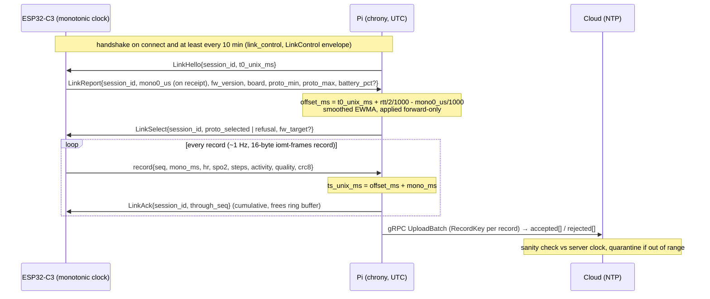
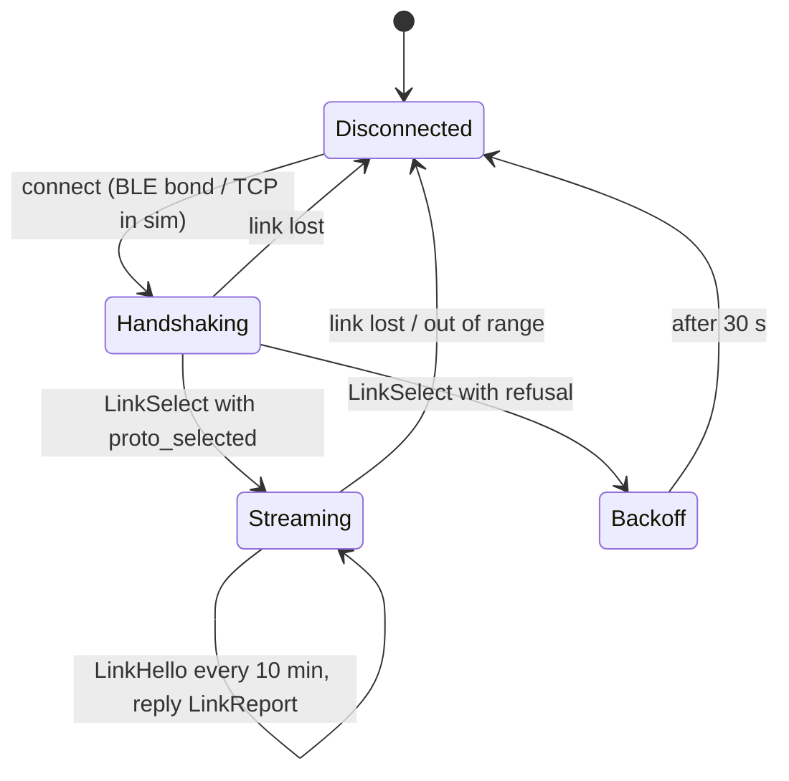
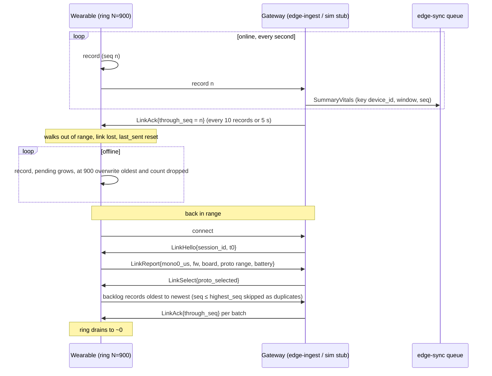
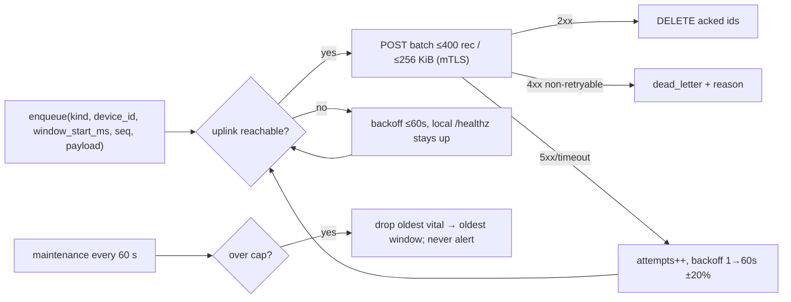
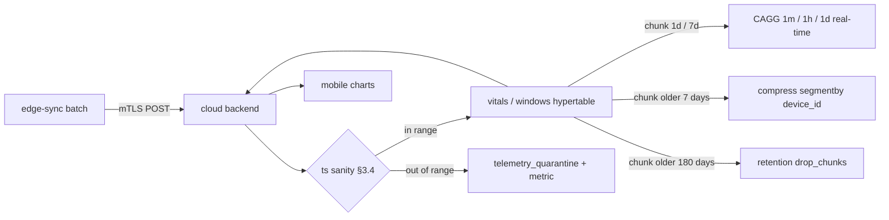
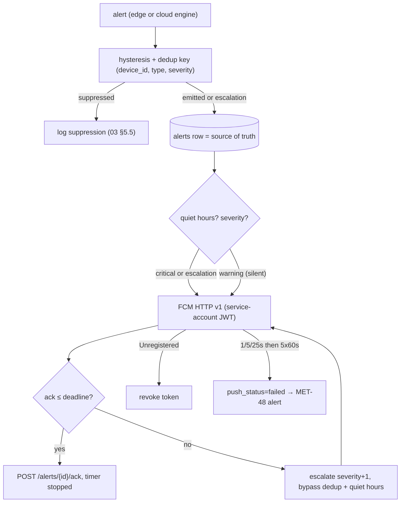

# 08 — Reliability, Time, Data Lifecycle, Backup & Updates

Design document (design only, no code — D10/D20). Binding inputs: `DECISIONS.md` (D1–D20), `01` (tree, §0/§2.1 budget, `deploy/`), `03` §7 (MET table format), `05` §8, `07` (security — ports, cert lifecycle, privacy). Namespaces introduced here: `REQ-REL-*`, `MET-40..MET-49`, `ADR-0017..ADR-0019`.

Assumptions used everywhere (**A1**): ≤ 30 nodes, ≤ 30 users, **1 Pi 3B+ (1 GB)**, **1 VPS (2 vCPU / 4 GB / 40 GB SSD)**, 1 Hz summary vitals + 1 window row per 30 s window per node (D18), demo scale = 5 nodes.

---

## 1. Goals and non-goals

**Goals**
1. One time model end-to-end (IoT → Pi → Cloud → Mobile) with a stated drift budget and no local time anywhere.
2. Edge→Cloud delivery that survives outages and power cuts without losing alerts and without wearing out the microSD (D19).
3. A cloud data lifecycle (chunk/compress/retain/roll up) sized with arithmetic for 30 nodes, and a matching Pi-side purge.
4. A backup/restore strategy a single student can operate, with numbers (RPO/RTO), a drill, and monitoring.
5. Safe updates: model OTA (existing, `[MVP]`), firmware OTA for ESP32-C3 (A/B + signed + rollback) and staged rollout (`[LATER]`, ADR-0020 — the MVP flashes over USB with an A/B-ready partition table), Pi software update/rollback (`[MVP]`).
6. Clinical push notifications with dedup, escalation, ack and a latency budget (`[MVP]`); quiet hours (`[LATER]`, ADR-0020) that never hide a critical alert when enabled.
7. An FMEA-lite view of the top failure modes with detection, automatic handling and operator action.

**Non-goals**
- NG1 No new long-running service on the Pi or the VPS (D13/D14/ADR-0008: no Redis, no MQ broker, no cache layer).
- NG2 No multi-region/HA, no automated failover, no Kubernetes on the Pi in the MVP (D13).
- NG3 No PTP/IEEE-1588, no leap-second handling (UTC only), no on-device RTC calibration lab.
- NG4 No backup of raw sample data on the Pi (raw is not durably stored in the MVP — `05 §1.4`).
- NG5 No SMS/e-mail/pager, no OneSignal, no automatic canary *analysis* (a human judges the canary) — all `[LATER]`.
- NG6 No change to alert *detection* logic or clinical thresholds; this doc covers transport/lifecycle of alerts only.

---

## 2. Requirements (numbered, testable)

Format per `03 §2` (atomic, RFC 2119, ≥1 test each). `REQ-REL-*` is this document's namespace; the WP mapping lives in `04 §7` acceptance lines (applied 2026-10-09). Tags below follow ADR-0020 (`01 §0`).

### 2.1 Time (REQ-REL-001..008)

| ID | Requirement | Verify (test) |
|---|---|---|
| REQ-REL-001 | Every timestamp stored, transported or displayed MUST be UTC epoch milliseconds (`int64`, `ts_unix_ms`); local time and timezone names MUST NOT appear in any schema, payload, log or DB column (mobile renders local time at display only). | T-REL-001-01: grep for `Local::now`, `AT TIME ZONE '` in `cloud/**`, `edge-lite/**` = 0 hits (mobile excluded) |
| REQ-REL-002 | The Pi MUST run `chrony` and MUST refuse to uplink until \|offset\| ≤ 120 s (extends `REQ-SEC-035`); after sync it MUST keep \|offset\| ≤ 1 s or mark rows `clock_state=unsynced`. | T-REL-002-01: boot with no NTP → uplink blocked; after fake NTP → allowed |
| REQ-REL-003 | The Pi MUST NOT durably enqueue rows before its first NTP sync; pre-sync samples MUST live only in the ≤ 120 s RAM ring of `edge-ingest`. | T-REL-003-01: cold boot offline 5 min → SQLite stays empty; ring serves local view |
| REQ-REL-004 | Each node MUST receive a UTC + monotonic anchor at BLE handshake (on connect and at least every 10 min); a sample `ts_unix_ms` MUST be derived as `anchor_utc_ms + (t_mono_us - anchor_mono_us)/1000`. | T-REL-004-01: recorded session timestamps match Pi reference within budget |
| REQ-REL-005 | The device→Pi timestamp error MUST stay ≤ 100 ms over any 10-min session (assumption: 40 MHz module XTAL, ± 20 ppm). | T-REL-005-01: 1 h trace, max deviation reported by MET-40 |
| REQ-REL-006 | A wall-clock step > 2 s MUST set `clock_state=unsynced`, force re-handshake for all connected nodes, and MUST NOT rewrite any already-enqueued row (rows are immutable once enqueued). | T-REL-006-01: injected step → flag set, re-handshake trace, enqueued rows byte-identical |
| REQ-REL-007 | The cloud MUST reject into a quarantine table (never silently drop) any row with `ts_unix_ms` outside `[gateway_enrolled_at − 5 min, server_now + 60 s]`, counting it per reason. | T-REL-007-01: future/past rows → 0 inserted, N quarantined, metric incremented |
| REQ-REL-008 | A duplicate idempotency key with identical payload MUST be accepted idempotently (200, `duplicate` count); the same key with a different payload hash MUST be quarantined as `idempotency_conflict` and alarmed. | T-REL-008-01: resend batch → duplicates=all; mutated duplicate → quarantined + alert |

### 2.2 Edge sync queue (REQ-REL-009..017)

| ID | Requirement | Verify (test) |
|---|---|---|
| REQ-REL-009 | `edge-sync` MUST be at-least-once: a record is durably committed to SQLite before any uplink attempt, and deleted only after a cloud 2xx that names it. | T-REL-009-01: kill -9 mid-flight → record re-sent on restart |
| REQ-REL-010 | The idempotency key of every uplink record MUST be exactly `(device_id, window_start_ms, seq)`; the cloud MUST enforce a unique index on it. | T-REL-010-01: schema assertion + duplicate-upload test |
| REQ-REL-011 | Upload MUST be FIFO by rowid, batch ≤ 400 records and ≤ 256 KiB; only acknowledged ids are deleted (no gaps). | T-REL-011-01: interleaved 3-device fixture preserves per-device `seq` order |
| REQ-REL-012 | Retry MUST be exponential (1,2,4,…,60 s) with ± 20 % jitter, and MUST NOT expire for `kind='alert'`. | T-REL-012-01: 30-min `iptables DROP` → backlog then full drain |
| REQ-REL-013 | The queue MUST cap at 500 000 rows, 128 MB file size, and age (vital 24 h, window 7 d, alert ∞), whichever triggers first. | T-REL-013-01: soak test crosses each cap → cap enforced, no alert row lost |
| REQ-REL-014 | Drop order MUST be: oldest `vital` rows first, then oldest `window` rows, never `alert` rows; every drop MUST be counted and exposed. | T-REL-014-01: forced overflow → alerts=0 dropped, `dropped_total{kind}` correct |
| REQ-REL-015 | A cloud 4xx that is not retryable MUST move the record to `dead_letter` with HTTP status + reason; a CLI MUST replay it idempotently. | T-REL-015-01: reject fixture → DLQ row; replay after fix → 0 duplicates |
| REQ-REL-016 | SQLite MUST run `journal_mode=WAL`, `auto_vacuum=INCREMENTAL`; the telemetry connection MUST batch (≤ 500 rows or ≤ 500 ms) with `synchronous=NORMAL` while the alert connection commits each alert with `synchronous=FULL`. | T-REL-016-01: `PRAGMA` assertions + crash injection (≤ 500 ms vital loss, 0 alert loss) |
| REQ-REL-017 | A `kill -9` MUST lose at most the current ≤ 500 ms batch of vitals and zero already-committed alerts. | T-REL-017-01: 100 randomized kills; loss histogram bounded |

### 2.3 Cloud data lifecycle (REQ-REL-018..022)

| ID | Requirement | Verify (test) |
|---|---|---|
| REQ-REL-018 | `vitals` (1 d chunks) and `windows` (7 d chunks) MUST be hypertables; chunks older than 7 d MUST be compressed (`segmentby=device_id`, `orderby=ts_unix_ms DESC`). | T-REL-018-01: migration + `chunk_compression_stats` after backdated fixture |
| REQ-REL-019 | Base tables MUST retain 180 d; a `retention` job MUST drop older chunks, and its failure MUST be alarmed. | T-REL-019-01: backdated chunk dropped; job-failure injected → alert |
| REQ-REL-020 | Continuous aggregates `vitals_1m`, `vitals_1h`, `vitals_1d` MUST exist with real-time aggregation enabled; refresh intervals 60 s / 15 min / 60 min; max lag ≤ 2× interval. | T-REL-020-01: insert → aggregate visible within 2 intervals; `materialized_only=false` asserted |
| REQ-REL-021 | The Pi MUST purge by the §2.2 caps and run `incremental_vacuum` after bulk deletes; a full `VACUUM` MUST be a documented runbook action only when free pages > 25 %. | T-REL-021-01: purge→free-page counter drops; runbook command checked |
| REQ-REL-022 | Late data within the retention window MUST be inserted normally (not rejected for age); only out-of-§2.1-range rows are quarantined. | T-REL-022-01: 6-day-old batch inserted with correct timestamps |

### 2.4 Backup / restore (REQ-REL-023..026)

| ID | Requirement | Verify (test) |
|---|---|---|
| REQ-REL-023 | PostgreSQL MUST use **pgBackRest**: continuous WAL archive + weekly full + daily differential; RPO ≤ 10 min and RTO ≤ 60 min. | T-REL-023-01: `pgbackrest info` timestamps; timed restore drill |
| REQ-REL-024 | An offsite encrypted copy MUST exist (`repo2` S3-compatible, built-in cipher); the passphrase MUST live in the sops+age secrets file, never in git plaintext. | T-REL-024-01: `pgbackrest info --repo=2`; gitleaks clean |
| REQ-REL-025 | A scripted restore drill MUST run monthly to a scratch container and assert: DB reachable, `count(vitals) > 0`, newest `ts_unix_ms` within 15 min of backup; failure MUST alert. | T-REL-025-01: drill script exit 0 + metric `restore_drill_success` |
| REQ-REL-026 | The Pi MUST be treated as stateless: a documented reflash + compose + enrol runbook MUST restore a gateway in ≤ 45 min with no Pi data backup. | T-REL-026-01: timed DR rehearsal on a spare SD |

### 2.5 Updates (REQ-REL-027..031)

| ID | Requirement | Verify (test) |
|---|---|---|
| REQ-REL-027 | **[LATER]** Firmware MUST use A/B OTA (`ota_0`/`ota_1` + `otadata`) and MUST verify an Ed25519 signature over `(sha256(image), version, board)` before selecting the new slot; the app MUST mark-valid only after health checks; a failed boot MUST roll back within 1 boot. | T-REL-027-01: tampered image refused; crash-loop image rolls back |
| REQ-REL-028 | **[LATER]** Firmware delivery MUST be cloud → `model-agent` (download, verify, version policy) → `edge-ingest` loopback `POST /internal/nodes/{id}/dfu` → BLE GATT chunks (≤ 244 B payload). | T-REL-028-01: end-to-end DFU trace for one node |
| REQ-REL-029 | The BLE handshake MUST negotiate a protocol version range; on no overlap the Pi MUST refuse node data and alarm; a node newer than its Pi MUST be blocked until the Pi is updated. | T-REL-029-01: handshake matrix test (§3.6.4) |
| REQ-REL-030 | Pi images MUST be pinned by digest; update = edit digest + `compose pull && up -d`; rollback = revert digest; the last two image versions MUST stay in the local cache. | T-REL-030-01: digest rollback smoke test |
| REQ-REL-031 | **[LATER]** Rollout MUST be staged: canary ≥ 24 h soak with 0 crashes/OOM and no alert-rate regression, then batches ≤ 25 % of the fleet every 30 min; any abort criterion stops the rollout. | T-REL-031-01: scripted rollout log + injected canary crash aborts |

**MVP trim (ADR-0020).** REQ-REL-027/028 (BLE firmware A/B OTA delivery) and REQ-REL-031 (staged/canary rollout) are `[LATER]` — the MVP flashes firmware over USB with an A/B-ready partition table (REQ-REL-027's layout only) and performs a manual digest-pinned deploy/rollback (REQ-REL-030). REQ-REL-029/030 remain `[MVP]`.

### 2.6 Push notifications and operations (REQ-REL-032..038)

| ID | Requirement | Verify (test) |
|---|---|---|
| REQ-REL-032 | Every emitted alert MUST fan out to all active push subscriptions via **FCM HTTP v1** (service-account JWT); the payload MUST contain only alert id + severity + type (no PHI). | T-REL-032-01: captured payload has no PHI; 3-subscriber fan-out |
| REQ-REL-033 | De-dup MUST use `(device_id, alert_type, severity)` with hysteresis, re-arm on condition end, and escalation MUST bypass de-dup (per `03 §5.5`); every suppression MUST be logged. | T-REL-033-01: chatter fixture → 1 push; escalation fixture → 2 pushes |
| REQ-REL-034 | **[LATER]** Quiet hours MUST NEVER suppress `critical` alerts or escalations (server-side hard rule, user cannot disable); `warning` MAY be silent; suppressed pushes MUST be logged. | T-REL-034-01: critical during quiet hours → delivered; setting forced false ignored |
| REQ-REL-035 | FCM retries MUST be 1/5/25 s then 5 × 60 s; `Unregistered`/`NotRegistered` MUST revoke the token immediately; tokens MUST be registered on app start and unique per device. | T-REL-035-01: fake 4xx → token revoked; duplicate token upsert |
| REQ-REL-036 | Alert→display MUST be p95 < 5 s (MET-09/MET-48); ack MUST cancel escalation; escalation deadlines MUST be critical 2 min, warning 10 min. | T-REL-036-01: synthetic alert latency test + ack stop test |
| REQ-REL-037 | Backup age, queue depth/drops, CAGG lag, clock sync, DFU result and push failure rate MUST be emitted as Prometheus metrics and alerted per doc 06. | T-REL-037-01: rule unit test with synthetic metric series |
| REQ-REL-038 | The system MUST sustain 30 nodes on one Pi within the §5.4 numbers without exceeding MET-11, MET-13 or MET-16. | T-REL-038-01: 30-node emulated load in `benchmarks` `[LATER]` |

**MVP trim (ADR-0020).** REQ-REL-032/033/035/036/037/038 are `[MVP]`; REQ-REL-034 (quiet hours) is `[LATER]` — alert de-dup, escalation, ack and the latency budget remain in the MVP.

### 2.7 Wearable offline buffer and BLE link session (REQ-REL-039..046, D21)

| ID | Requirement | Verify (test) |
|---|---|---|
| REQ-REL-039 | The wearable MUST write every sample into its on-device ring buffer **before** any transmission attempt, whether or not a link is up. | T-REL-039-01: planned `Courier` host test — record with no link → `pending()` grows by 1 per sample |
| REQ-REL-040 | The ring MUST hold at least 15 min at 1 Hz (900 records); when full it MUST overwrite the **oldest** record and increment a `dropped` counter. | T-REL-040-01 (`RingBuffer` unit tests, passing): push N+k records into capacity N → oldest k gone, `dropped()==k`; planned `device-sim --out-of-range-for 1000` → gateway logs a seq gap |
| REQ-REL-041 | A record MUST leave the ring only on a cumulative `LinkAck{through_seq}` that covers its `seq`; sending MUST NOT remove anything. | T-REL-041-01: `peek_batch` leaves `pending()` unchanged; `on_ack(s)` removes exactly the records with `seq ≤ s` |
| REQ-REL-042 | After every (re)connection and successful `LinkSelect`, the wearable MUST resend all unacknowledged records oldest-first before or interleaved with new ones, preserving `seq` order. | T-REL-042-01: planned `device-sim` out-of-range 20 s → every buffered sample received after return, 0 lost |
| REQ-REL-043 | The wearable MUST NOT stream records before a `LinkSelect` carrying `proto_selected`; on `refusal` it MUST disconnect and retry no sooner than 30 s later. | T-REL-043-01: planned `device-sim --proto-min 2 --proto-max 3` → gateway sends `LINK_REFUSAL_NODE_TOO_NEW`, logs ALARM, no record accepted |
| REQ-REL-044 | The gateway MUST drop a record whose CRC-8 fails, and MUST treat a record whose `seq` is ≤ the highest `seq` already received for that device (across reconnections) as a duplicate: not stored again, but still covered by the next ack. | T-REL-044-01: resend after reconnect → `duplicates ignored` count > 0, no duplicate vitals |
| REQ-REL-045 | The gateway MUST acknowledge at least every 10 new records or every 5 s while records arrive, whichever comes first. | T-REL-045-01: gateway stub log shows `ack through seq` cadence; device `pending()` stays ≤ ~10 while online |
| REQ-REL-046 | The gateway MUST derive the pseudonymous `device_id` from the BLE address as the lowercase hex of the first 16 bytes of SHA-256(address); the address itself MUST NOT leave the gateway (07 REQ-SEC-001). | T-REL-046-01: `device_id_for` unit test — stable, distinct per address, address bytes not readable |

**MVP trim.** REQ-REL-039..046 are `[MVP]`. **Status 2026-10-12: partly implemented.** Firmware side: `RingBuffer` (REQ-REL-040 and the removal half of 041) is written by the user in `iot-node/firmware/crates/offline-buffer/src/ring.rs` with 6 passing unit tests; `Courier` (039, 041 sending side, 042–043) is next. The gateway side (044–046) in `edge-ingest` (MVP-04), with `tools/device-sim` as the planned host-side test bed. The user writes this code themselves (learning Rust); an earlier generated version was removed on purpose.

---

## 3. Design

### 3.1 Single time model (UTC unix ms)

One representation everywhere: `ts_unix_ms: int64` = milliseconds since 1970-01-01T00:00:00Z. Postgres stores `timestamptz` built from the unix ms (UTC); Rust uses `i64` ms; the mobile app converts to local time **only at render**. There is no separate timezone, no DST table, no leap-second handling.

| Layer | Clock/source | Accuracy assumption | Enforcement |
|---|---|---|---|
| ESP32-C3 | `esp_timer` from the 40 MHz module XTAL; boot-relative monotonic `t_mono_us` | ± 20 ppm (± 1.7 s/day) | never trusted as wall clock; anchored at handshake |
| Pi | `chrony` over LAN NTP (router) + VPS fallback; `makestep 1.0 3` only for the first 3 updates | LAN ≤ 10 ms, Wi-Fi ≤ 50 ms | `REQ-REL-002` gate; step detection `REQ-REL-006` |
| VPS/Cloud | host NTP (`chrony`) | ≤ 10 ms | server timestamps authoritative |
| Mobile | system clock, display only | — | never used for alert ordering |

`chrony` config (documented in `deploy/pi/chrony.conf`, owner MVP-07): `pool <lan-ntp> iburst`, `server <vps-ip> iburst minpoll 4 maxpoll 6`, `makestep 1.0 3`, `rtcsync`, `driftfile /var/lib/chrony/drift`. A DS3231 I2C RTC is `[LATER]` (only useful when the Pi boots with no network for hours; it would seed the clock at boot so the local display is usable before NTP).

### 3.2 How the ESP32 gets time and how sample timestamps are derived

`[MVP]` uses the **connection handshake** (our own `link_control` GATT characteristic), not the standard BLE Current Time Service (`[LATER]`). Rationale: we already need a handshake for protocol/firmware version negotiation (`REQ-REL-029`) and OTA targeting, whereas CTS would require the ESP32 to run a second GATT **client** role plus service discovery for no additional benefit at 1–30 nodes.



- **Concrete messages:** the handshake and acks are the `LinkControl` messages of `shared/protocols/proto/iomt/firmware/v1/firmware.proto`; version choice is `iomt_protocol::link::negotiate()` (newest common version, else `LinkRefusal` `NODE_TOO_NEW` / `NODE_TOO_OLD` / `INVALID_RANGE` ⇒ Pi refuses the node's data and raises an alarm, REQ-REL-029).
- **Unit note (open point):** the handshake reports `mono0_us` (u64, µs) but each 16-byte record carries `mono_ms` (u32, ms; wraps after ≈ 49.7 days of uptime). The Pi must convert `mono0_us / 1000` before combining, which costs ≤ 1 ms of resolution — well inside the 100 ms device→Pi budget. Either keep this (documented) or move the record to µs in a later frame version; until then `t_mono_us` in older text means `mono_ms × 1000`.
- `offset` is recomputed on every handshake and never moved backwards for already-sent frames; if a correction would move a timestamp backwards it is applied only to future frames and the gap is recorded as a `session_boundary`.
- **Drift budget**: ± 20 ppm × 600 s = **12 ms** per 10-min session; the most pessimistic case (no handshake for a whole 8 h power-on) is 8 × 3600 × 20e-6 = **0.58 s**, still inside the ± 1 s `unsynced` threshold. Design budget: device→Pi ≤ **100 ms p95**; full chain (device + Pi NTP 50 ms + server NTP 10 ms + network asymmetry 20 ms) ≤ **200 ms p95**, ≤ 500 ms worst case, inside the 300 ms E2E display target (MET-02).
- The ESP32 clock is **not** a wall clock: if the node loses the Pi, it re-syncs at the next connection; no local timestamp is trusted once the link drops.
- Firmware CTS (`0x1805`) and DS3231 are `[LATER]`.
- The messages (`firmware.v1`) and the version choice (`iomt_protocol::link::negotiate`) exist; the handshake itself (device side, `edge-ingest/src/ble/handshake.rs`, and the planned `tools/device-sim`) is not implemented yet.

### 3.2b Wearable offline buffer and link session — detailed design (D21)

This section is the detailed design of the IoT↔Pi link at the record level. §3.2 covers the time anchor; this covers what is stored, what is sent, when it is removed and how the gateway turns a record into vitals. **It is the target design: apart from the rows marked done below, the code is not written yet** — the user implements it to learn Rust. `RingBuffer` exists; `Courier`, `record`, `peek_batch`, `on_ack` are the intended API, not existing code yet.

**Code that implements it**

| Part | Path | Status |
|---|---|---|
| 16-byte record encode/decode + CRC-8 | `iot-node/firmware/crates/iomt-frames` | done (no_std, host tests) |
| `RingBuffer<N>` (FIFO, overwrite oldest + `dropped`, `ack_through`) | `iot-node/firmware/crates/offline-buffer/src/ring.rs` | done by the user (no_std, 6 unit tests) |
| `Courier<N>` + `Sample` (seq numbering, `record`, `peek_batch`, `on_ack`, `pending`, `dropped`) | `iot-node/firmware/crates/offline-buffer/src/courier.rs` | in progress (user writes it next; module commented out in `lib.rs`) |
| Link messages `LinkHello/Report/Select/Ack` | `shared/protocols/proto/iomt/firmware/v1/firmware.proto` | done |
| Version negotiation | `shared/rust/src/link.rs` (`negotiate`, `select_message`) | done |
| Record → validated `SummaryVitals` | `edge-ingest` (planned; `to_vitals`) on top of `shared/rust/src/domain.rs` (done) | not implemented yet (to be written by the user) |
| Simulated wearable + gateway stub over TCP | `tools/device-sim` | not implemented yet (to be written by the user) (§3.2b.8) |
| Firmware BLE GATT glue (`ble-transport`) and real `edge-ingest/src/ble/` | `iot-node/firmware/crates/ble-transport`, `edge-gateway/edge-lite/services/edge-ingest` | not started |

#### 3.2b.1 Record format (`iomt-frames`, one GATT notification per record)

| Offset | Size | Field | Meaning |
|---|---|---|---|
| 0 | 4 | `seq` | u32 LE, +1 per sample, first sample after boot = 1 |
| 4 | 4 | `mono_ms` | u32 LE, device monotonic ms since boot (wraps after ≈ 49.7 days) |
| 8 | 2 | `hr_bpm` | u16 LE, `0` = not available |
| 10 | 1 | `spo2_pct` | u8, `0` = not available |
| 11 | 2 | `steps` | u16 LE, steps counted in this second |
| 13 | 1 | `activity` | u8: rest / walk / run / unknown |
| 14 | 1 | `quality` | u8, 0..=100 |
| 15 | 1 | `crc8` | CRC-8/SMBUS (poly 0x07, init 0) over bytes 0..15 |

Protobuf is deliberately not used for samples: 16 fixed bytes fit one BLE notification and cost no allocation on the MCU.

#### 3.2b.2 Device-side buffer

- `RingBuffer<N>` (`src/ring.rs`, done): fixed array `slots`, `head` = oldest, `len`, `capacity()`; `new()` rejects `N = 0` at compile time; `push` overwrites the oldest when full and increments `dropped` (saturating). RAM only: **N = 900** → 15 min at 1 Hz, 900 × 16 B ≈ 14 KB of RAM (the struct holds decoded `Record`s; size is of the same order).
- `Courier<N>` wraps the ring: `record(Sample)` — `Sample` = `{mono_ms, hr_bpm, spo2_pct, steps, activity, quality}`, one struct instead of six arguments — assigns `seq` (starts at 1, `wrapping_add`) and pushes; `peek_batch()` copies the oldest records **without** removing them; `on_ack(through_seq)` removes from the head while `seq ≤ through_seq`; `pending()` and `dropped()` are the counters reported in logs/metrics.
- The sender keeps `last_sent` **per connection** (reset to 0 on every new connection). Each tick it sends every pending record with `seq > last_sent`, oldest first. Consequence: after a reconnection the whole unacknowledged backlog is resent once, and while online nothing is sent twice.

#### 3.2b.3 Device link session (state machine)



Every second, in every state: (1) sample → `record` (always first, REQ-REL-039); (2) if `Streaming`, send pending records newer than `last_sent`; (3) until the next tick, answer link control at once — `LinkHello` → `LinkReport` immediately (a delayed reply would skew the offset by half the delay), `LinkAck` → `on_ack`. Records are never sent in `Handshaking` and `Backoff`; they keep accumulating in the ring.

#### 3.2b.4 Gateway receive pipeline (per connection)

1. **Identity:** BLE address (in the sim: the first `PeerAddress` frame) → `device_id = hex(SHA-256(address)[0..16])` (REQ-REL-046).
2. **Handshake:** on connect and every 600 s send `LinkHello{random session_id, t0_unix_ms}`; accept only the `LinkReport` with the same `session_id` (a late reply to an older hello is ignored); `negotiate(gateway_range, node_range)` → `LinkSelect`. Refusal ⇒ log an **ALARM** and close; the device's data is ignored.
3. **Offset:** `offset_ms = t0_unix_ms + rtt_ms/2 − mono0_us/1000`. Records that arrive before the first offset are ignored (the device does not send them anyway).
4. **Per record:** decode + CRC (bad ⇒ drop, log) → duplicate check `seq ≤ highest_seq[device_id]` (kept across reconnections; duplicate ⇒ count, skip) → gap check (`seq > highest+1` ⇒ log "lost on the device", i.e. ring overflow) → `ts_unix_ms = offset_ms + mono_ms` → `SummaryVitals` (`0` ⇒ `None`; `SignalQuality::new`; `validate()`: HR 20..=250, SpO₂ 50..=100) → valid rows go to windowing/queue (in `edge-ingest`), invalid rows are logged and still acknowledged (resending would not fix them).
5. **Ack:** when there are un-acked new records and (≥ 10 new records **or** ≥ 5 s since the last ack), send `LinkAck{session_id, through_seq = highest_seq}` (REQ-REL-045).

#### 3.2b.5 Out-of-range scenario end to end



#### 3.2b.6 Parameters

| Parameter | Value | Where |
|---|---|---|
| Sample rate | 1 Hz | firmware / `device-sim` |
| Ring capacity | 900 records (15 min) | `RING_CAPACITY` |
| Ack cadence | every 10 new records or 5 s | gateway (`--ack-every`, `ACK_EVERY`) |
| Re-handshake | on connect + every 600 s | gateway (`REHANDSHAKE_EVERY`, REQ-REL-004) |
| Refusal backoff | 30 s | device (`REFUSAL_BACKOFF_S`) |
| Link protocol range | 1..=1 today | both sides (`--proto-min/--proto-max`) |

#### 3.2b.7 Failure cases

| Case | Behaviour | Loss |
|---|---|---|
| Link drops mid-backlog | nothing was removed without ack; on reconnect the rest (plus the un-acked part already sent) is resent | 0; duplicates skipped by seq |
| `LinkAck` lost | records stay pending, resent after the next reconnection, or covered by the next cumulative ack | 0 |
| Out of range > 15 min | oldest overwritten, `dropped` counted; gateway logs a seq gap | the overwritten samples (counted) |
| Corrupted record (CRC) | dropped and logged; **not** re-requested — the next ack covers a higher seq, so it is lost | 1 record (counted in logs; metric to add in `edge-ingest`) |
| Late `LinkReport` from an older hello | ignored by `session_id` | 0 |
| Protocol mismatch | `LinkSelect{refusal}`, ALARM, close; device retries after 30 s; data keeps accumulating in its ring | overwrite if it lasts > 15 min |
| Gateway restart | if `highest_seq` is kept only in RAM ⇒ resent records are accepted again; downstream idempotency key absorbs them | 0 (duplicates downstream) |
| Wearable reboot / power loss | RAM ring lost; `seq` restarts at 1, `mono_ms` at 0 | buffered samples lost; **see open point 1** |

#### 3.2b.8 Development simulator (`tools/device-sim`) — planned, not built

Planned: `device-sim device` runs N wearables using the real `iomt-frames`, `offline-buffer` and `firmware.v1` code; `device-sim gateway` is the stub described in §3.2b.4 (not `edge-ingest`: no windowing, inference, queue or upload). TCP replaces BLE with the framing `[kind u8: 1 peer address | 2 link control | 3 record][len u16 LE ≤ 512][payload]` (`src/wire.rs`). Scenarios: `normal`, `out-of-range` (`--out-of-range-at/--out-of-range-for`), `high-hr` (HR forced ≈ 155 bpm > 140 alert threshold), and protocol mismatch via `--proto-min/--proto-max`. Vitals come from a seeded generator (`physio.rs`: rest/walk/run, HR drifts toward an activity target, quality drops with movement, quality < 40 ⇒ HR/SpO₂ not available), so a seed reproduces a wearer. Acceptance when built: 2 devices, 20 s out of range ⇒ every buffered sample resent, 0 lost, duplicates ignored; protocol mismatch ⇒ `LINK_REFUSAL_NODE_TOO_NEW` + alarm. (A generated prototype passed exactly this on 2026-10-12 and was then removed so the user can write it.)

**Order:** 04 (MVP-03/MVP-04) and REQ-DEMO-001 put recorded fixtures + `edge-ingest --replay` first; the user may build the live simulator first instead. Recorded fixtures (`iot-node/firmware/test/fixtures/`) and `--replay` are open; a simulator could record them. A future `edge-ingest` may accept the TCP transport next to BLE, which also enables a 30-node load test without hardware (REQ-REL-038).

#### 3.2b.9 Open points

1. **Seq reset on reboot.** With the design as written, `seq` restarts at 1 after a wearable reboot, but the gateway keeps `highest_seq` per device, so every new record is treated as a duplicate until `seq` passes the old maximum. Options: (a) add a boot counter (e.g. `boot_id`, persisted in NVS) to `LinkReport` and dedupe on `(device_id, boot_id, seq)`; (b) persist `next_seq` in NVS (flash wear: write every K samples and skip ahead K on boot); (c) reset `highest_seq` when `mono0_us` is smaller than at the previous handshake. To decide before `edge-ingest` (MVP-04).
2. **Ring is RAM only.** Power loss loses up to 15 min of buffered samples. Acceptable for the MVP (D21 does not require persistence); flash-backed buffer is `[LATER]`.
3. **Units:** handshake `mono0_us` (µs, u64) vs record `mono_ms` (ms, u32, wraps ≈ 49.7 days) — see §3.2.
4. **Offset smoothing:** a simple stub may use the single latest handshake; `edge-ingest` must add the EWMA and forward-only rule of §3.2.
5. **Pi-side dedupe state:** RAM is enough for a stub; `edge-ingest` should persist `highest_seq` (SQLite) or rely on the downstream idempotency key.
6. **CRC-failed records are not re-requested** (cumulative ack only). Acceptable at BLE link-layer error rates; a NACK would need a new `LinkControl` message (`firmware.v2` or an added field).

### 3.3 Pi clock jumps at boot

1. **Before first NTP sync** (Pi just booted, possibly no network): the wall clock may be garbage. `edge-ingest` buffers samples in its RAM ring only; `edge-sync` durably enqueues nothing (`REQ-REL-003`). The local gateway REST still serves the ring for the offline dashboard.
2. **Step > 2 s detected** (chrony correction or manual): set `clock_state=unsynced`, force re-handshake for every connected node so future frames use the corrected anchor, keep all already-enqueued rows byte-for-byte (`REQ-REL-006`). Rows written during an unsynced window carry `flags.clock_unsynced=1` and `ts_quality='best_effort'`.
3. **Uplink gate**: batch upload is allowed only when `|chrony offset| ≤ 120 s` at first, then `≤ 1 s` steady-state; a failing gate raises a Prometheus metric (`clock_offset_seconds`) and a doc 06 alert.
4. Rows enqueued while unsynced are still uploaded once the gate passes; the cloud decides their fate by the §3.4 sanity rules.

### 3.4 edge-sync store-and-forward queue

`edge-sync` owns one SQLite database (default `/var/lib/edge-sync/queue.db`, path configurable — D19). Payloads are serialized protobuf `BLOB`s (encode once at ingest, decode once at cloud); the queue is a durable outbox, not a read cache (ADR-0008).



**Semantics.** At-least-once (durable before send; delete after 2xx). Idempotency key `(device_id, window_start_ms, seq)`; `window_start_ms` for a 1 Hz vital is its 1 s bucket start, for a window row it is the window start (this is the same tuple the cloud enforces — `REQ-REL-010`). Ordering is FIFO by `id`; per-device `seq` order is preserved because we delete exactly the ids we sent. Duplicate delivery is harmless because of the key.

**Retry/backoff.** 1,2,4,8,16,32,60 s + ± 20 % jitter; alerts retry forever; vitals/windows retry until the age cap drops them. A `4xx` that is not `408/429` is treated as non-retryable → DLQ.

**Caps and drop policy** (`REQ-REL-013/014`): 500 000 rows **or** 128 MB file **or** age (vital 24 h, window 7 d, alert ∞). On overflow the maintenance task deletes oldest `vital` rows first, then oldest `window` rows; `alert` rows are never dropped, and if the queue is full of only alerts the service raises a local alarm (LED/buzzer) and log. Depth/age/bytes are the doc 06 gauges `iomt_sync_queue_rows`, `iomt_sync_queue_oldest_seconds`, `iomt_sync_queue_bytes`; every drop increments a **new** counter `iomt_sync_queue_dropped_total{kind}` (MET-43; registered in the doc 06 metric catalogue).

**Dead-letter + replay.** `dead_letter(id, kind, device_id, window_start_ms, seq, payload, http_status, error, created_at, replayed_at)`. CLI subcommand `edge-sync dlq list|replay --since-24h` re-POSTs rows; because the cloud key is unique, replay is idempotent. Runbook `docs/runbooks/queue-replay.md`.

**SQLite schema sketch** (file `edge-gateway/edge-lite/services/edge-sync/src/queue/schema.sql`, owner MVP-04):

```sql
PRAGMA page_size=4096;
PRAGMA auto_vacuum=INCREMENTAL;   -- must be set before the first table is created
PRAGMA journal_mode=WAL;
PRAGMA synchronous=NORMAL;        -- telemetry connection (group commit)
PRAGMA wal_autocheckpoint=128;    -- 512 KiB -> checkpoint roughly every 40 s
PRAGMA journal_size_limit=1048576;-- truncate -wal/-shm back after checkpoint
PRAGMA temp_store=MEMORY;
PRAGMA mmap_size=16777216;        -- 16 MiB address space; RSS only for touched pages
PRAGMA cache_size=-4096;          -- 4 MiB page cache (telemetry conn)
PRAGMA busy_timeout=5000;
PRAGMA foreign_keys=ON;

CREATE TABLE uplink_records (
  id             INTEGER PRIMARY KEY,          -- FIFO order
  kind           TEXT    NOT NULL,             -- vital | window | alert
  device_id      TEXT    NOT NULL,             -- 32 hex (hashed, no PII)
  window_start_ms INTEGER NOT NULL,
  seq            INTEGER NOT NULL,
  ts_unix_ms     INTEGER NOT NULL,
  payload        BLOB    NOT NULL,             -- protobuf, encoded once
  attempts       INTEGER NOT NULL DEFAULT 0,
  next_attempt_ms INTEGER NOT NULL,
  enqueued_ms    INTEGER NOT NULL,
  flags          INTEGER NOT NULL DEFAULT 0
);
CREATE UNIQUE INDEX ux_uplink_idem ON uplink_records(device_id, window_start_ms, seq);
CREATE INDEX ix_uplink_id ON uplink_records(id);

CREATE TABLE dead_letter (
  id INTEGER PRIMARY KEY, kind TEXT NOT NULL, device_id TEXT NOT NULL,
  window_start_ms INTEGER NOT NULL, seq INTEGER NOT NULL, payload BLOB NOT NULL,
  http_status INTEGER, error TEXT, created_at_ms INTEGER NOT NULL, replayed_at_ms INTEGER
);
```

**PRAGMA justification vs SD wear (D19).** WAL turns random page rewrites into sequential appends and copies at checkpoint, so the SD sees large sequential writes instead of many small random ones; `synchronous=NORMAL` moves fsync from every commit to checkpoints, so the **fsync rate** (the wear-relevant erase operation) is ~2/min instead of 2/s; `wal_autocheckpoint=128` bounds the power-loss window to ~40 s of vitals (acceptable for historical telemetry, `05 §2b`); `journal_size_limit` stops the `-wal` file growing forever; `auto_vacuum=INCREMENTAL` + periodic `incremental_vacuum` reclaims space cheaply after the drop policy deletes rows (a full `VACUUM` would rewrite the whole DB and is runbook-only); `mmap_size`/`cache_size` trade RAM (inside the 64 MB limit) for fewer read syscalls. **Alerts** are committed on a second connection with `PRAGMA synchronous=FULL`, so an alert survives a power cut while vitals tolerate a ≤ 500 ms window; alerts are rare (< 1/s) so the extra fsyncs are negligible.

### 3.5 Cloud data lifecycle



**Hypertables.** `vitals` = 1 d chunks (at 30 nodes that is ~2.6 M rows/chunk, ~310 MB uncompressed — fine for 512 MB `shared_buffers`; only the last day is uncompressed at any time). `windows` = 7 d chunks (~86 400 rows/day → ~108 MB after 7 d). Compression after 7 days: `segmentby=device_id`, `orderby=ts_unix_ms DESC`, giving ~8× on numeric vitals (`03 §7.1` guidance). Retention 180 days (governance), enforced by `drop_chunks`. Late data inside the window is inserted normally (`REQ-REL-022`).

**Continuous aggregates** (all `[MVP]` per D18): `vitals_1m` (avg hr, min spo2, count, max activity per device/min), `vitals_1h`, `vitals_1d`; `materialized_only = false` so the newest minute is always queryable (real-time aggregation); refresh policies 60 s / 15 min / 60 min; the 7-day chart reads `vitals_1m`, so MET-14 stays < 200 ms even at 30 nodes. Retention on the CAGGs themselves is `[LATER]` (the base retention controls them).

**Pi-side retention.** Same table as the queue: vitals 24 h, windows 7 d, drain-for-space caps per §3.3; `incremental_vacuum` runs after each bulk delete, full `VACUUM` only in the runbook when free pages > 25 %. Local gateway REST serves the last 6 h of vitals from this table when the cloud is unreachable (no extra store).

### 3.6 Updates

#### 3.6.1 Model OTA (unchanged)

Existing design stands (ADR-0006, `03 §5.4`): immutable `name-semver+build`, HTTP ETag = sha256 + conditional GET (304 skips the ~5 MB download), **always** re-verify Ed25519+SHA256 before apply. `model-agent` owns it.

#### 3.6.2 Firmware OTA (new, ESP32-C3) — `[LATER]` (ADR-0020)

*(Design retained for the deferred phase; the MVP flashes over USB with the A/B-ready partition table and does not exercise the slot-switch/DFU path.)*

- **Partitioning** (`iot-node/firmware/partitions.csv`, owner MVP-03): require **4 MB flash** modules (WROOM-02); `nvs 24K`, `otadata 8K`, `phy 4K`, `ota_0 1.5M`, `ota_1 1.5M`, `model_store` (spiffs) ≈ 0.9 MB. A 2 MB module cannot host A/B and is rejected.
- **Signing and verification:** the release root/CI key of `07 §3.9` signs a manifest `(sha256(image), version, board, min_bootloader)`. The **device** computes SHA256 over the written slot and verifies Ed25519 with its embedded public key **before** calling `esp_ota_set_boot_partition`. A failed verification leaves the running slot untouched. Secure boot v2 + monotonic anti-rollback counter are `[LATER]` (07 REQ-SEC-036/037); MVP residual: a physically-flashed attacker image is not blocked, documented in the threat model.
- **Rollback:** after switching, the app marks itself valid only after (a) 10 s uptime, (b) BLE GATT advertising, (c) one successfully processed window, (d) clock handshake OK. Otherwise `esp_ota_mark_app_invalid_rollback_and_reboot()` returns to the previous slot within one boot (`REQ-REL-027`).
- **Delivery path:** cloud registry → `model-agent` (download with mTLS, verify signature/SHA256, version policy) → loopback `POST /internal/nodes/{id}/dfu` on `edge-ingest` → BLE GATT write characteristic (≤ 244 B payload, write-with-response + credit window). Effective throughput assumption **~10 KB/s** (15–30 ms connection interval) ⇒ a 1 MB image ≈ 100 s, a 1.5 MB image ≈ 150 s; target ≤ 180 s/node (MET-47). DFU runs only when node battery > 30 % and no active clinical session; at most one DFU per adapter at a time; DFU is throttled to ≤ 30 % duty so ingest is not starved.

#### 3.6.3 Pi and cloud software updates

- Images pinned by digest in `deploy/compose/compose.pi3.yml` / `compose.prod.yml`; the current and previous digests are documented in `CHANGELOG.md`.
- Update = edit digest in git → `docker compose pull && docker compose up -d`; rollback = revert digest + `up -d` (previous image still in the local cache). Only the last two versions are kept to bound disk.
- Pi OS: `unattended-upgrades` for security patches [MVP] (07 REQ-SEC-031); a full OS release upgrade is a runbook task `[LATER]`.
- Cloud runs the same images via Compose; dev uses `compose.dev.yml` profiles, prod `compose.prod.yml`. No K8s on the Pi (D13); the same digests can move to K8s later.

#### 3.6.4 Version compatibility matrix and negotiation

Handshake carries `fw_version` (semver), `proto_min`, `proto_max`, `model_schema_version`. Pi replies with `proto_selected = clamp_to_range(max(node.proto_max, pi.proto_min))`; if the ranges do not overlap the Pi refuses node data and raises an alert. Rules:

| Node fw | proto vs Pi | Model schema | Outcome |
|---|---|---|---|
| 1.1.x | `proto_minor` ≤ Pi | same major | compatible; OTA optional |
| 1.1.x | `proto_major` < Pi | same major | Pi translates/ignores unknown fields (proto3 rule), node is `update_recommended` |
| 1.1.x | `proto_major` > Pi | — | node blocked (`needs_pi_update`), no data accepted, alert raised |
| 2.0.x | any | any | firmware major change requires new OTA manifest + eval; OTA only in the `[LATER]` window |
| any | any | model newer than fw | `model-agent` refuses the model (`min_fw` unmet) |

Ordering rule: **Pi before node, cloud before Pi** — never push a node firmware whose `proto_min` exceeds the running Pi's `proto_max`.

#### 3.6.5 Staged rollout — `[LATER]` (ADR-0020)

Canary = 1 node (firmware) or the arm64 dev container (Pi services/cloud) for ≥ 24 h; abort criteria: crash/OOM counter > 0, alert-rate or inference-latency regression > 20 %, MET-40..48 breach. Then batches of ≤ 25 % of the fleet every 30 min; a failed batch stops the rollout and triggers the rollback runbook. Automation beyond the abort check is `[LATER]`; the MVP rollout is a scripted, human-supervised sequence (MET-49).

### 3.7 Clinical push notifications



- **Provider**: `[MVP]` **FCM HTTP v1** called with `reqwest` + a Google service-account JWT (minted with the existing JWT crypto crate) — no deprecated SDK, no legacy server key. OneSignal is `[LATER]` (third-party DPA + account). SMS/e-mail fallback is `[LATER]`.
- **Tables**: `push_subscriptions(id, user_id, platform, fcm_token, app_version, last_seen_ms, revoked_ms)` with a unique index on `fcm_token`; `alerts` row is the source of truth (persist before push); `push_delivery(alert_id, subscription_id, attempt, status, fcm_message_id, sent_ms)`.
- **Fan-out and retries**: one FCM message per active subscription; `collapse_key=(device_id, alert_type, severity)` so retries/duplicates collapse on the phone; retry policy per `REQ-REL-035`; `Unregistered` revokes the token; stale tokens not seen for 90 d are purged by a monthly job.
- **Ack and escalation**: `POST /api/v1/alerts/{id}/ack {action: acknowledged|snoozed|false_alarm}` stops the timer; no ack within **2 min (critical)** / **10 min (warning)** raises severity and re-sends to the care group, bypassing dedup and quiet hours.
- **Quiet hours** (`[LATER]`, ADR-0020): per-user fixed `tz_offset_min` (no TZ database in the MVP) + `quiet_start_min`/`quiet_end_min` (minutes from local midnight). Server rule: `critical` and escalations are **always** delivered immediately and cannot be disabled; `warning` may be delivered silently; `info` is suppressed and logged (daily digest `[LATER]`).
- **Alert→display latency budget** (p95): edge commit + uplink **0.4 s** + dedup/persist/fan-out **0.1 s** + FCM accept→phone display **2.0 s** (assumption: FCM p95 ≈ 2 s) + mobile render **0.2 s** = **2.7 s** < 5 s (MET-09/MET-48), leaving 2.3 s headroom.

---

## 4. Interfaces

### 4.1 Ports and listeners (extends `07 §4.1`; no new exposure)

| Where | Endpoint | Exposure | Auth | Purpose |
|---|---|---|---|---|
| Cloud | `9443/tcp` axum mTLS | public, cert-gated | mTLS + registry status | `POST /api/v1/edge/telemetry`, `/api/v1/edge/alerts`, `POST /api/v1/firmware/{v}/install`, `GET /api/v1/firmware/{v}/download` |
| Cloud | `443/tcp` Caddy | public | JWT | `POST /api/v1/push/register`, `POST /api/v1/alerts/{id}/ack`, `GET /api/v1/admin/ops/queue` |
| Pi | `127.0.0.1:9102` `edge-sync` (internal `api` module; former `gateway-api`, D14) | loopback only | local trust | `GET /healthz`, `GET /internal/queue/stats` |
| Pi | `127.0.0.1:9101` `edge-ingest` (internal `api` module) | loopback only | local trust | `POST /internal/nodes/{id}/dfu` (`[LATER]`, firmware DFU) |
| Pi | BLE GATT | RF ≤ 10 m | LESC bond | telemetry frames, `link_control` handshake, DFU characteristic |
| — | MQTT/AsyncAPI | none in MVP (D14) | — | no topic is added by this design |

### 4.2 Cloud endpoints added or extended

Contract owner: MVP-01 (`shared/protocols/openapi/cloud-api.openapi.yaml`).

| Method + path | Auth | Purpose |
|---|---|---|
| `POST /api/v1/edge/telemetry` (extend) | mTLS | add records of kind `vital`/`window`; idempotency key `(device_id, window_start_ms, seq)`; returns `{accepted, duplicate, quarantined}`; 4xx for a poison batch. **Realised in MVP-01 as gRPC** `iomt.telemetry.v1.TelemetryIngestService/UploadBatch` (`telemetry.proto`): duplicates count as `accepted`, quarantine/invalid/unknown device come back per record in `rejected[]` with a `RejectReason`; a gRPC error status means retry the whole batch |
| `POST /api/v1/edge/alerts` (extend) | mTLS | edge-originated alerts enter the same engine (dedup/escalation) |
| `POST /api/v1/push/register` | JWT | upsert `fcm_token` on app start; returns subscription id |
| `DELETE /api/v1/push/register` | JWT | unregister current device token (logout) |
| `POST /api/v1/alerts/{id}/ack` | JWT | acknowledge/snooze/false-alarm; stops escalation |
| `GET /api/v1/admin/ops/queue` | admin JWT | per-gateway queue depth/attempts/dropped counters `[MVP]` read-only |
| `GET /api/v1/firmware` | JWT + RBAC | firmware version list + status per node |

### 4.3 Repo file locations (owner = MVP WP of `04 §7`)

| Path | Tag | Owner | Content |
|---|---|---|---|
| `deploy/pi/chrony.conf` | `[MVP]` | MVP-07 | NTP sources, `makestep`, drift file |
| `deploy/backup/pgbackrest.conf` | `[MVP]` | MVP-07 | stanza, repo1 local + repo2 S3, retention, cipher |
| `deploy/backup/backup.sh`, `restore-drill.sh` | `[MVP]` | MVP-07 | cron entrypoint + monthly drill (exit code → metric) |
| `deploy/observability/prometheus/rules/backup.rules.yml` + `tests/backup.test.yml` | `[MVP]` | MVP-07 | extend the doc 06 rules: `IomtBackupFailed` (critical 30 h), `IomtEdgeQueueAge` (from doc 06), plus new `IomtEdgeQueueDropped`, `IomtBackupVerifyFailed`, `IomtTimescaleJobStuck`, `IomtPushFailureRate`; `IomtFirmwareOtaFailed` `[LATER]` |
| `deploy/compose/compose.pi3.yml` (edit) | `[MVP]` | MVP-07 | pin digests; declare `edge-sync` volume + `read_only`; keep mem/cpu limits |
| `edge-gateway/edge-lite/services/edge-sync/src/queue/schema.sql` | `[MVP]` | MVP-04 | SQLite schema + PRAGMAs (§3.4) |
| `edge-gateway/edge-lite/services/edge-sync/src/queue/dlq.rs` | `[MVP]` | MVP-04 | `edge-sync dlq list|replay` subcommand |
| `edge-gateway/edge-lite/services/edge-sync/src/queue/maintenance.rs` | `[MVP]` | MVP-04 | caps, purge, `incremental_vacuum`, clock gate |
| `iot-node/firmware/crates/offline-buffer/` | `[MVP]` | MVP-03 | `src/ring.rs` `RingBuffer` done; `src/courier.rs` `Courier` in progress (§3.2b.2) |
| `iot-node/firmware/crates/iomt-frames/` | `[MVP]` | MVP-03 | 16-byte record + CRC-8 (§3.2b.1), done |
| `tools/device-sim/` | `[MVP]` | MVP-02 | simulated wearables + gateway stub over TCP (§3.2b.8), planned — not present |
| `edge-gateway/edge-lite/services/edge-ingest/src/ble/handshake.rs` | `[MVP]` | MVP-04 | time anchor, proto negotiation |
| `edge-gateway/edge-lite/services/edge-ingest/src/ble/dfu.rs` | `[LATER]` | MVP-04 | DFU GATT server + `/internal/nodes/{id}/dfu` (firmware OTA over BLE, ADR-0020) |
| `edge-gateway/edge-lite/services/model-agent/src/ota/firmware.rs` | `[LATER]` | MVP-04 | firmware download/verify/version-policy/rollback (firmware OTA, ADR-0020) |
| `iot-node/firmware/partitions.csv` (edit) | `[MVP]` | MVP-03 | A/B-ready layout `ota_0`/`ota_1` + `otadata` (§3.6.2); MVP flashes by USB, slot-switch `[LATER]` |
| `iot-node/firmware/crates/ota-client/` (new crate) | `[LATER]` | MVP-03 | DFU receive, verify, mark-valid, rollback |
| `cloud/backend/migrations/*_lifecycle.sql` | `[MVP]` | MVP-05 | hypertables, CAGGs, compression/retention policies, quarantine |
| `cloud/backend/migrations/*_push.sql` | `[MVP]` | MVP-05 | `push_subscriptions`, `push_delivery` (quiet-hours `user_settings` `[LATER]`) |
| `cloud/backend/src/alerts/` | `[MVP]` | MVP-05 | dedup/escalation/quiet-hours engine + FCM sender |
| `shared/protocols/proto/iomt/firmware/v1/firmware.proto` | `[MVP]` | MVP-01 | OTA manifest (sha256, version, board, signature) |
| `shared/protocols/jsonschema/push-registration.v1.schema.json` | `[MVP]` | MVP-01 | push registration body |
| `docs/runbooks/{backup-restore,queue-replay,pi-disaster-recovery,ota-rollback}.md` | `[MVP]` | MVP-02/07 | procedures below (`ota-rollback.md` extended to firmware OTA sign-off; `firmware-ota-rollback.md` `[LATER]`) |
| `benchmarks/scripts/reliability/` | `[LATER]` | RW-11 | MET-40..49 harness |

---

## 5. Resource impact

### 5.1 Pi 3B+ (1 GB) — reliability deltas (canonical budget in `03 §7.1`; operating cap ≤ ~400 MB)

| Item | Δ RAM | Δ CPU | Δ disk | Assumption |
|---|---|---|---|---|
| `edge-sync` SQLite (telemetry cache 4 MiB + alert cache 0.5 MiB + WAL buffers ~2 MiB + ~2 MiB touched mmap) | **+8 MB RSS** (request 32 → steady ~40 MB, limit 64 MB) | encode 30 rows/s × ~2 µs = **0.006 %** core + maintenance every 60 s | DB = queue (≤ 128 MB) + WAL (≤ 1 MiB) | `05 §1.4` row ≈ 100 B; `cache_size=-4096` |
| `edge-ingest` handshake/DFU | 0 steady (DFU buffer ≤ 8 KB) | DFU ≤ 30 % duty during transfer | 0 | one DFU at a time/adapter |
| `model-agent` firmware cache | already budgeted | verify ≈ 0.1 ms (Ed25519, `07 §5.1`) | ≤ 2 firmware images × 1.5 MB = 3 MB + model 5 MB | keep last 2 versions |
| `chrony` (host, not container) | ~3 MB in the OS baseline 150–200 MB | negligible | drift file only | `01 §2.1` baseline |
| **Total added** | **~8 MB RSS**, **0 new container** | < 1 % average | ≤ ~136 MB disk (queue cap + artifacts) | within MET-11 |

**MET-13 (canonical target in `03 §7`; absorbs MET-42).** MET-13 is now the single SD-write metric: **SD writes ≤ 1.0 GB/day** at the D18 load (~1 Hz summary vitals + per-window rows; hard ceiling 1.5 GB/day) and **commit rate: batch ≤ 500 rows or fsync ≤ 500 ms; sustained fsync ≤ 0.2/s**. `01 §2.1`'s old "MVP ~17 MB/day" was the *logical payload* of the superseded 1-row/s window model and is stale. At D18 the **on-disk** number is dominated by SQLite page granularity, not by payload: a 4 KB page is rewritten per commit and once more at checkpoint, so ~2 commits/s ⇒ ~8 KB/s WAL + ~4 KB/s checkpoint ≈ **12 KB/s ≈ 1.0 GB/day**, essentially independent of node count because the ≤ 500 ms commit floor sets it. 1 GB/day on a 10–30 TBW high-endurance card ≈ 27–82 years of endurance, so D19's risk conclusion is unchanged. **MET-42 is reserved/unused (merged into MET-13, 2026-10-09).**

### 5.2 Cloud VPS — storage arithmetic at 30 nodes / 180 d

Row assumptions: vitals tuple ~80 B + indexes ~40 B = **120 B/row**; 30 nodes × 1 Hz = 30 rows/s = **2.592 M rows/day** ≈ **310 MB/day uncompressed**; compression ≈ **8×**; windows 86 400 rows/day × 180 B ≈ 15.5 MB/day.

| Dataset | Uncompressed | With 7 d hot + 8× compression, 180 d |
|---|---|---|
| `vitals` | 56 GB | 2.2 GB hot + 6.7 GB compressed = **8.9 GB** |
| `windows` | 2.8 GB | **0.45 GB** |
| `vitals_1m` | 43 200 rows/day → 7.8 M rows/180 d ≈ 0.78 GB | **0.8 GB** (1h/1d negligible) |
| indexes/WAL/catalog/temp | — | **~2 GB** |
| **DB total** | | **≈ 14 GB** |

Backups (pgBackRest, zstd; Timescale-compressed data compresses poorly, assume full ≈ 0.8 × DB): **full ≈ 11 GB**, differential ≈ cumulative changed pages ≤ 2 GB, 24 h WAL ≈ 2.5 GB. repo1 keeps **1 full + 6 diffs + 24 h WAL ≈ 15 GB**. Disk budget: live 14 + repo1 15 + WAL 1 + OS/Docker ≈ 6 = **36 of 40 GB** at full 30-node/180 d scale → alert threshold at 34 GB used (MET-44). At MVP demo scale (5 nodes) the same budget is **~12 GB**, so the pressure only exists at full fleet; the first lever is retention (90 d ⇒ 7 GB live), the second is an 80 GB disk (`[LATER]`).

RAM: the reliability work adds no new cloud container — FCM sender and alert engine live in the existing backend (+5 MB); pgBackRest runs transiently inside the Postgres container. The cloud demo footprint (**including `step-ca`**) is canonical in `03 §7.3`; see also `07 §5.2`.

### 5.3 Capacity plan — 30 nodes

| Resource | Demand | Assumption | Verdict |
|---|---|---|---|
| BLE bandwidth | 30 × 3 KB/s = 90 KB/s; 30 notif/s (10-sample batching at 100 Hz) | `05 §1.2` | trivial for BLE 5 |
| BLE connections | 30 > 7–10/adapter ⇒ **4 USB adapters** (`hci0..3`) | `01 §2.4`, MET-16 | MVP demo = 5 nodes / 1 adapter; 4 adapters `[LATER]` |
| Pi CPU | 3000 samples/s × ~10 µs = **3 %** core + windowing + 1 inference/window/node | A53 @ 1.4 GHz | fits the 1.15 core CPU limit |
| Pi RAM | 240 MB limit / ≤ 400 MB cap (MET-11) + 8 MB SQLite | §5.1 | fits |
| Pi disk | queue ≤ 128 MB + artifacts ~8 MB + OS | D19 | ≤ 5 % of a 32 GB card |
| Edge uplink | (30 vitals/s + 1 window/s) ≈ 4.5 KB/s ≈ 0.39 GB/day | 120/180 B/row | 30× below a home link |
| Cloud writes | 2.6 M rows/day ≈ 30 rows/s | Timescale 10⁴–10⁵ ins/s | trivial |
| Cloud DB | 14 GB / 180 d | §5.2 | fits 40 GB with backup budget |
| Push | worst case 30 alerts in 5 s | FCM quota far above | trivial |
| Queue outage cover | 500 k rows ≈ 4.6 h at 30 rows/s; 128 MB ≈ 7.9 h; alert-age ∞ | §3.4 | exceeds the 30 s no-loss requirement (`05 §2b`) |

---

## 6. MVP vs LATER

| Item | Tag | Owner |
|---|---|---|
| UTC unix-ms single time model + chrony on Pi + uplink clock gate | `[MVP]` | MVP-04/07 |
| Time in BLE handshake (anchor + proto/fw negotiation) | `[MVP]` | MVP-03/04 |
| BLE Current Time Service (0x1805) on the device | `[LATER]` | — |
| DS3231 I2C RTC on the Pi | `[LATER]` | — |
| SQLite WAL + dual-connection `synchronous` + batched commit | `[MVP]` | MVP-04 |
| At-least-once queue + `(device_id, window_start_ms, seq)` idempotency | `[MVP]` | MVP-04/05 |
| Caps, tiered drop policy, DLQ + replay CLI | `[MVP]` | MVP-04 |
| Server-side timestamp sanity + quarantine table | `[MVP]` | MVP-05 |
| Hypertables + 1 d/7 d chunks + compression (7 d) + retention (180 d) | `[MVP]` | MVP-05 |
| CAGGs 1 m / 1 h / 1 d with real-time aggregation | `[MVP]` | MVP-05 |
| CAGG retention policies | `[LATER]` | — |
| Pi purge + `incremental_vacuum` | `[MVP]` | MVP-04 |
| pgBackRest continuous WAL archive + weekly full + daily diff | `[MVP]` | MVP-07 |
| Offsite `repo2` (S3-compatible, encrypted) | `[MVP]` | MVP-07 |
| Nightly `pgbackrest verify` + monthly restore drill + Prometheus rules | `[MVP]` | MVP-07 |
| Pi stateless DR runbook (`pi-bootstrap` + reflash + enrol) | `[MVP]` | MVP-02/07 |
| Golden Pi image / automated enrolment | `[LATER]` | — |
| Model OTA (existing) | `[MVP]` | MVP-04 |
| Firmware A/B-ready partition table + USB flashing | `[MVP]` | MVP-03 |
| Firmware OTA over BLE (A/B slot switch + Ed25519 verify + mark-valid rollback + BLE DFU) | `[LATER]` | — |
| Firmware secure boot v2 + flash encryption + anti-rollback counter | `[LATER]` | — |
| Pi/cloud digest-pinned pull + digest rollback | `[MVP]` | MVP-07 |
| Staged/canary rollout script (≤ 25 % batches) | `[LATER]` | — |
| Automatic rollout analysis/auto-abort | `[LATER]` | — |
| FCM HTTP v1 push + token table + ack + escalation | `[MVP]` | MVP-05/06 |
| Quiet-hours rules | `[LATER]` | — |
| OneSignal provider | `[LATER]` | — |
| SMS / e-mail fallback channel | `[LATER]` | — |
| Info-severity daily digest | `[LATER]` | — |

---

## 7. Acceptance criteria and new metrics (MET-40..MET-49)

Columns per `03 §7`. Acceptance for this design = every `[MVP]` `REQ-REL` row of §2 has a green test `T-REL-*` plus the metrics below; `[LATER]` rows (REQ-REL-027/028/031/034 and MET-42/47/49) are deferred per ADR-0020. Until the `benchmarks` package exists (`[LATER]`), the measurements below are run by the named runbooks/scripts (MVP) as `07 §7` already does.

| id | name | target | unit | how measured | where | owner |
|---|---|---|---|---|---|---|
| MET-40 | Device→Cloud timestamp accuracy | p95 ≤ 200 ms, max ≤ 500 ms per 10-min session | ms | injected UTC reference at handshake; compare stored `ts_unix_ms` vs Pi chrony reference over 24 h | Pi + Cloud | MVP-04 |
| MET-41 | Queue durability & drain | kill -9 loss ≤ 500 ms of vitals, 0 alerts; drain ≥ 1 000 rec/s after outage | rec/s, ms | 100 randomized `kill -9` + 30-min `iptables DROP` then timed catch-up | Pi (`edge-sync`) | MVP-04 |
| MET-42 | **Reserved/unused** — merged into **MET-13** (2026-10-09); do not re-measure SD writes under this ID | — | — | — | — | — |
| MET-43 | Queue cap/age compliance | caps never exceeded; `iomt_sync_queue_dropped_total` = 0 (vital/window) in 30 d at demo load | rows, MB, h | doc 06 gauges `iomt_sync_queue_rows/bytes/oldest_seconds` + drop counter | Pi | MVP-04 |
| MET-44 | Cloud storage @30 nodes/180 d | DB ≤ 18 GB; repo1 ≤ 12 GB; disk used ≤ 34/40 GB | GB | `pg_database_size` + `hypertable_size()` + `df` weekly | Cloud | MVP-05 |
| MET-45 | CAGG freshness & maintenance jobs | lag ≤ 2× refresh interval; compression/retention jobs 100 % success/day | min; % | `_timescaledb_*` job stats + `chunk_compression_stats` | Cloud | MVP-05 |
| MET-46 | Backup RPO/RTO & drill | RPO ≤ 10 min; RTO ≤ 60 min; nightly pgBackRest backup; ≥ 1 documented restore drill | min; count | `pgbackrest info` timestamps + `restore-drill.sh` exit code | Cloud | MVP-07 |
| MET-47 | Firmware OTA success & rollback — `[LATER]` (MVP flashes by USB; partition table is A/B-ready) | ≥ 95 % first-attempt success; 100 % bad-image rollback ≤ 1 boot; ≤ 180 s/node | %; s | OTA counters + injected tampered/crash-loop image (OTA test `[LATER]`) | Pi + IoT | MVP-03/04 |
| MET-48 | Push latency & success | alert→display p95 < 5 s; FCM success ≥ 99 %/24 h; quiet-hours rules `[LATER]` | s; % | synthetic alert every 15 min + push log | Cloud + Mobile | MVP-05/06 |
| MET-49 | Rollout safety — `[LATER]` | canary ≥ 24 h soak with 0 crashes/OOM before fleet; ≤ 25 % fleet per stage | h; % | rollout log + crash counters (rollout log `[LATER]`) | Cloud + Pi | MVP-07 |

---

## 8. Failure modes and mitigations (FMEA-lite)

| # | Failure mode | Effect | Detection | Automatic handling | Operator action |
|---|---|---|---|---|---|
| F-01 | BLE connection drop (node↔Pi) | Missing samples/windows for that node | `edge-ingest` link counter + `node_offline` metric | Reconnect with backoff; node keeps sampling and re-syncs timestamps at handshake; missing frame → quality flag | Check RF/adapter load, re-bond, move node closer |
| F-02 | MCU brownout / reset | Timestamp anchor lost, partial batch | Boot counter in next handshake | Node re-handshakes; seq restarts but `window_start_ms` keeps the key unique; boot event logged | Check power/charging; escalate wearable battery design |
| F-03 | Pi power loss (hard cut) | Up to ≤ 500 ms vitals lost, 0 alerts, DB may be mid-WAL | Uptime reset on boot + SQLite recovery | WAL recovers on open; unsent rows replayed; clock gate blocks uplink until NTP | Verify `fsck`/DB integrity (runbook), replace PSU/USB if recurring |
| F-04 | SD card corruption / full | Queue unreadable or writes fail | SQLite `SQLITE_IOERR`/`disk full` + MET-13/43 | Freeze writes, raise local alarm, keep RAM ring for alerts; switch to read-only mode | Restore from reflash (stateless Pi) + enrol; swap to SSD/USB (D19) |
| F-05 | Cloud outage / partition | Backlog grows; no push | Uplink 5xx/timeout + heartbeat gap ≥ 60 s | Backoff and buffer (≤ caps); local REST serves 6 h; alerts retried forever | Confirm VPS/network; fix and watch drain (MET-41) |
| F-06 | DB disk full (cloud) | Inserts fail, backend errors | `pg` disk + MET-44 alarm | Reject/quarantine new batch (no partial writes), stop non-essential jobs, alert | Drop a retention chunk early or expand disk (runbook) |
| F-07 | Clock jump / NTP unavailable | Mis-timestamped rows, cert validation risk | `clock_offset_seconds` + step detection | Block uplink (`REQ-REL-002`), re-handshake nodes, mark `clock_unsynced`, never rewrite enqueued rows | Check NTP source/router; manual `chronyc makestep` only per runbook |
| F-08 | Bad model (accuracy regression) | Wrong/absent alerts | Eval drop (MET-05) + implausible-vitals / quality spikes | `model-agent` rollback to previous version; PI inference flags degraded | Compare model cards, re-run eval, re-issue model OTA |
| F-09 | Bad firmware image | Node boot loop / dead node | Device rollback event + OTA failure metric | Bootloader returns to previous slot ≤ 1 boot; new image blocked | Pull firmware version, inspect manifest/signature, re-sign or revert |
| F-10 | Certificate expiry (mTLS leaf) | Uplink refused | `cert_expiry_days` metric + failed handshake | Auto-renew at day 60 (`07 REQ-SEC-005`); retry every 6 h | Re-issue via `step-ca` on the VPS (`step` CLI in dev; `07 §3.3`), check clock if renewal failed |
| F-11 | Queue overflow (long outage) | Old vitals/windows dropped | `edge_queue_dropped_total` + cap alarm | Drop oldest vital → window; never alerts; local alarm | Restore link, confirm drain and alert integrity; decide if data gap matters |
| F-12 | Push provider down (FCM) | Alerts not displayed | Synthetic-alert probe + ≥ 99 % target (MET-48) | Retry 1/5/25 s then 5 × 60 s; app poll fallback every 30 s | Check FCM status/quota; consider SMS fallback `[LATER]` |
| F-13 | Backup failure (silent) | No restore point | `pgbackrest_last_*_backup_age` rule | Job retries next cycle; alert after 26 h (warn) / 48 h (crit) | Inspect pgBackRest log/repo disk; run manual backup |
| F-14 | Timescale job failure (compression/retention stuck) | Disk grows unbounded | MET-45 + job stats | Job retries; disk alarm; pause new retention-sensitive jobs | Run manual `add_compression_policy`/`drop_chunks` per runbook |
| F-15 | Stale push token (reinstall) | Missed pushes for one user | FCM `Unregistered` | Revoke token immediately; app re-registers on next start | Ask user to open app / re-check notification permission |
| F-16 | Idempotency conflict / DLQ never replayed | Silent data gap | `idempotency_conflict` metric + DLQ row age | Quarantine conflicting row; DLQ retains payload | Replay after fix (`edge-sync dlq replay`), then purge after 30 d |
| F-17 | Certificate/clock skew too large for TLS | Cannot connect at all | Handshake failure + clock metric | Retry with backoff; block until synced | Manual clock fix on the Pi (runbook) |

---

## 9. Decisions taken (no open questions)

### 9.1 New ADRs (id range ADR-0017..ADR-0019)

**ADR-0017 — One time model: UTC epoch milliseconds everywhere; time is anchored at the BLE handshake, chrony disciplines the Pi, durable enqueue is gated on NTP.**
*Decision:* all timestamps are `ts_unix_ms` (int64 UTC ms) in every schema, payload, DB and log; the ESP32 has no trusted wall clock and derives sample time from a boot-relative monotonic counter plus a handshake anchor from the Pi (connection + at least every 10 min); the Pi runs chrony, blocks uplink outside ± 120 s (then ± 1 s), and re-handshakes after any > 2 s step; no row is rewritten.
*Rationale:* this removes timezone/DST/leap-second classes of bugs, keeps the device cheap (no RTC, no CTS client), and turns the only hard clock requirement into one gate that security (`REQ-SEC-035`) already needs; the ± 20 ppm XTAL assumption keeps the 100 ms/10-min budget comfortably inside the 300 ms E2E target (MET-02). DS3231 and BLE CTS are deferred because they only help the narrow case of a long offline boot.

**ADR-0018 — The edge→cloud contract is an at-least-once SQLite outbox keyed by `(device_id, window_start_ms, seq)`, with tiered drops that never lose alerts.**
*Decision:* `edge-sync` durably writes protobuf payloads to a WAL-mode SQLite outbox before any send, deletes them only after a cloud 2xx naming them, and relies on a unique idempotency key server-side; caps (500 k rows / 128 MB / age) trigger a drop order of oldest vitals → oldest windows → never alerts; non-retryable rejections go to a dead-letter table with a replay CLI; telemetry commits are batched with `synchronous=NORMAL` while alerts commit with `synchronous=FULL`.
*Rationale:* at-least-once plus a natural key is the boring, provably-lossless-for-alerts design at 1 Hz; the split durability gives alert safety without paying an fsync per vital, which is exactly the trade-off D19 needs on a microSD; a dead-letter table is the minimum that prevents a poison batch from blocking the queue forever.

**ADR-0019 — Backup = pgBackRest with continuous WAL archiving, a local repo and an encrypted offsite repo; the Pi is stateless.**
*Decision:* choose **pgBackRest** over wal-g; weekly full + daily differential + continuous WAL archive to repo1 (local) and an encrypted repo2 (S3-compatible, built-in cipher), RPO ≤ 10 min / RTO ≤ 60 min, nightly `verify` and a monthly restore drill; the Pi has no data backup because reflash + compose + enrol restores it in ≤ 45 min.
*Rationale:* one binary, one config file and built-in `check`/`verify`/`restore --delta`/parallelism beat hand-rolled WAL-push scripts for a student-operated single VPS, and pgBackRest's native S3 repo + cipher satisfy the "encrypted before leaving the VPS" rule of `07 §3.4` with one less moving part than a separate age/restic pipeline; backing up the stateless Pi would add cost with no recovery value.

### 9.2 Every other question resolved here

| Question | Resolution (1 line each) |
|---|---|
| Handshake vs BLE CTS vs RTC for device time | **Handshake** (ADR-0017); CTS and DS3231 `[LATER]`. |
| How is `ts_unix_ms` derived on the device | `anchor_utc_ms + (mono_ms − mono0_us/1000)` with the anchor from `LinkHello`/`LinkReport` (§3.2), EWMA-smoothed, forward-only. |
| Maximum drift budget | ≤ 100 ms/10-min session (20 ppm), ≤ 200 ms p95 full chain (MET-40). |
| Pi boot with no network | Ring-only, no durable enqueue until first NTP (REQ-REL-003). |
| Pi clock step mid-session | Re-handshake, `clock_unsynced` flag, never rewrite enqueued rows. |
| Out-of-range cloud timestamps | **Quarantine** (enrolment−5 min .. now+60 s), counted + logged; nothing silently dropped. |
| Idempotency key | Exactly `(device_id, window_start_ms, seq)`; conflict with a different hash → quarantine + alarm. |
| Queue ack semantics | Delete only ids named in a 2xx batch; duplicate delivery expected and harmless. |
| Cloud-outage behaviour | Backoff ≤ 60 s forever, buffer within caps, local dashboard from the same table. |
| Drop policy | Oldest vital → oldest window → never alert; drops counted (MET-43). |
| DLQ + replay | Pi-side `dead_letter` table + `edge-sync dlq replay` CLI; 30 d then purge. |
| SQLite journal/sync/checkpoint | WAL + dual `synchronous` + 128-page/60 s checkpoint; justified vs SD wear in §3.4. |
| TimescaleDB chunk interval | `vitals` 1 d, `windows` 7 d (only the last day uncompressed). |
| Compression policy | Chunks > 7 d, `segmentby=device_id`, `orderby=ts_unix_ms DESC`, ~8×. |
| Retention policy | 180 d base tables (governance); CAGG retention `[LATER]`. |
| CAGGs | `vitals_1m/1h/1d`, real-time aggregation ON, refresh 60 s/15 min/60 min (D18 = MVP). |
| Pi retention & vacuum | Vitals 24 h, windows 7 d, `incremental_vacuum` after bulk deletes, full `VACUUM` runbook-only. |
| pgBackRest vs wal-g | **pgBackRest** (ADR-0019). |
| Backup encryption | pgBackRest `repo2-cipher=aes-256-cbc`; passphrase in the sops+age secrets file (reconciles `07 §3.4`: same "encrypted before leaving the VPS" guarantee, one pipeline). |
| Backup schedule & retention | Weekly full, daily diff, continuous WAL; repo1 = 1 full + 6 diffs + 24 h WAL; repo2 keeps 4 weekly fulls. |
| RPO/RTO | ≤ 10 min / ≤ 60 min (single VPS restore); offsite restore ≤ 4 h `[LATER]`. |
| Restore drill frequency | Nightly `verify`; monthly scripted restore to a scratch container (MET-46). |
| Model registry & config backup | Artifact volume inside the backup pipeline; config = git (sops-encrypted); root/age/pgBackRest passphrases in an offline copy. |
| Pi DR | Stateless: reflash OS + `tools/scripts/pi-bootstrap.sh` + `compose up -d` + enrol; ≤ 45 min. |
| Backup monitoring | doc 06 metric `iomt_host_backup_last_success_timestamp_seconds` + rule `IomtBackupFailed` (critical at 30 h); warn at 26 h. |
| Firmware partition layout | 4 MB flash: `nvs 24K/otadata 8K/phy 4K/ota_0 1.5M/ota_1 1.5M/model_store ~0.9M`. |
| Firmware signing/verification | Device verifies Ed25519 over `(sha256, version, board)` before selecting the new slot. |
| Firmware rollback trigger | Mark-valid after health checks; else rollback within one boot. |
| Firmware DFU transport | BLE GATT chunks ≤ 244 B, ~10 KB/s, one node/adapter at a time, ≤ 180 s/node. |
| Who owns OTA | `model-agent` orchestrates (download/verify/policy); `edge-ingest` only moves bytes over BLE. |
| Secure boot / flash encryption / anti-rollback | `[LATER]` (07 REQ-SEC-036/037); residual documented. |
| Version negotiation | Handshake ranges; no overlap → refuse + alarm; rule cloud→Pi→node ordering. |
| Pi update/rollback | Digest-pinned compose pull; revert digest; last 2 versions cached. |
| Staged rollout | Canary ≥ 24 h, batches ≤ 25 %/30 min, abort on crash/OOM/regression; analysis manual `[LATER]`. |
| Push provider | FCM HTTP v1 + service-account JWT; OneSignal/SMS `[LATER]`. |
| Quiet-hours rules | Critical + escalation always delivered (server-side, non-disableable); warning may be silent; info suppressed+logged. |
| Push retries / bad token | 1/5/25 s then 5 × 60 s; `Unregistered` revokes immediately; stale tokens purged monthly. |
| Alert latency budget | 0.4 + 0.1 + 2.0 + 0.2 = 2.7 s p95 < 5 s (MET-09/MET-48). |
| VPS sizing | Unchanged 2 vCPU/4 GB/40 GB; lifecycle + backup fit in 36 GB at 30 nodes; first lever = retention. |

---

## 10. Applied edits

Applied to 01/03/04 on 2026-10-09 (see ADR-0020 and 04 section 7).
